# Trivia Game Data Flow Diagram

Status: M1 design baseline. Authority: [system design](system-design.md).
Contracts: [LLD](low-level-design.md). Constraints: [database design](database-design.md).
Component ownership: [HLD](HLD_Component_Diagram.md).

Diagrams show runtime messages, not dependency imports. ACK reports a command outcome;
versioned snapshots represent state. Publish snapshots only after actual mutations,
using viewer-safe projections; no-op/rejection does not advance version.

## 1. Authentication Flow

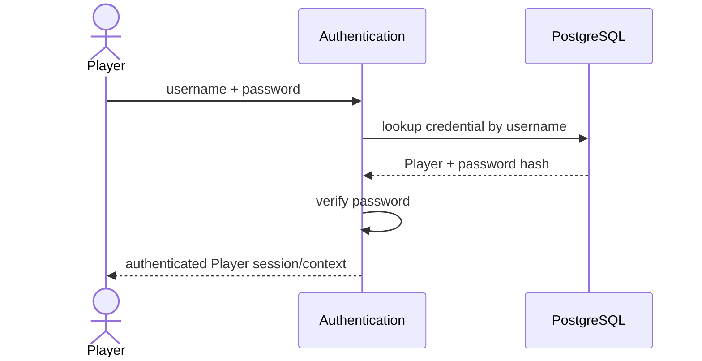

Resolve username/password credentials to a durable Player after hash verification. Authentication/session transport details remain unspecified; gameplay never trusts username/socket identity as Player identity.

## 2. Create Match Flow

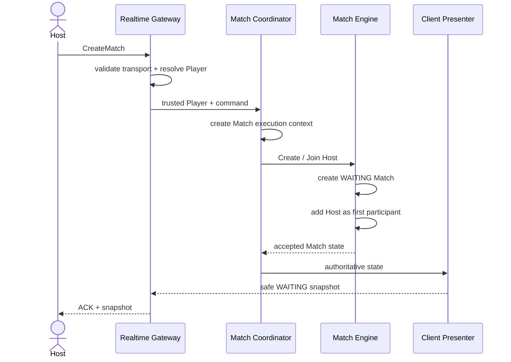

Server generates Match identity and makes the authenticated creator Host/first participant in `WAITING`. No auto-start or Ready state.

## 3. Join Match Flow

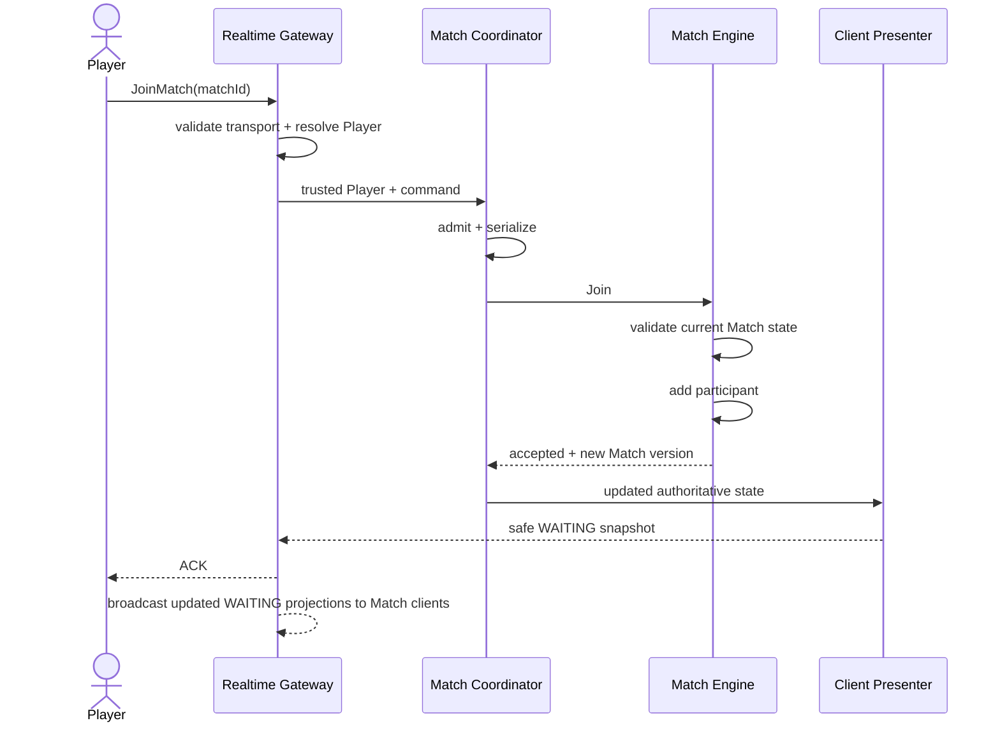

Engine validates `WAITING`, no duplicate Player, and at most 10 participants. Publish updated lobby snapshots to all remaining Match clients, not only the joiner.

## 4. Waiting Participant Leave Flow

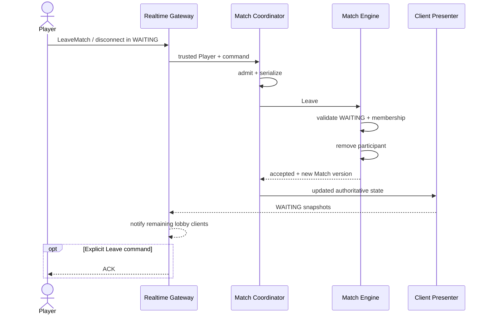

A non-Host leave **or disconnect** in `WAITING` removes membership and notifies remaining clients. No ghost participant or bot replacement. Host departure and active-game disconnect/reconnect remain open.

## 5. Start Match Flow

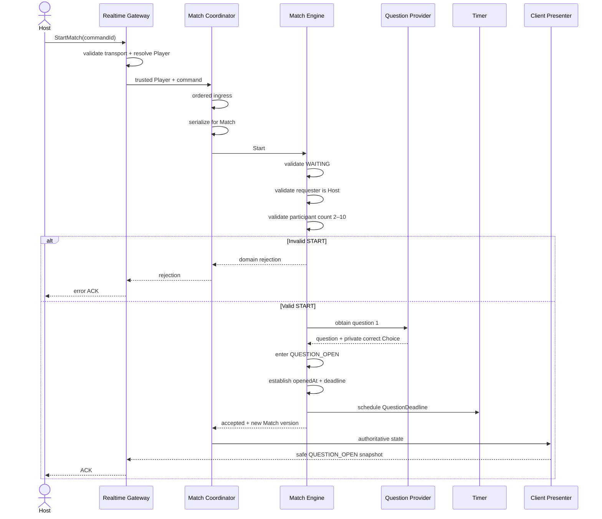

Only the Host starts. Validate current `WAITING` membership at processing: 2–10 opens question 1; fewer than 2 rejects without mutation/version change. No client-supplied question/deadline.

## 6. Ordered Command Ingress

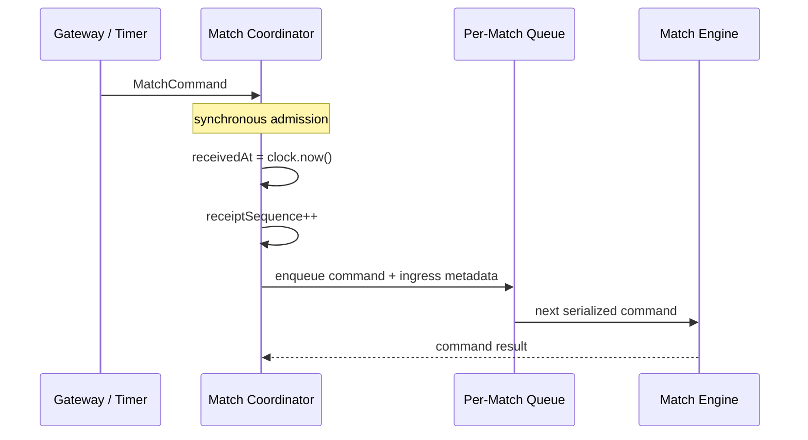

Clock read, receipt sequencing, and queue position are one non-yielding admission operation. Player and Timer commands share the per-Match FIFO path; different Matches execute independently. Processed command-ID retries return established outcomes without re-execution.

## 7. Submit Answer Flow

```mermaid
sequenceDiagram
    actor P1 as Player
    participant G as Realtime Gateway
    participant C as Match Coordinator
    participant E as Match Engine
    participant V as Client Presenter

    P1->>G: SubmitAnswer(commandId, questionId, choiceId)
    G->>G: validate transport + resolve Player
    G->>C: trusted Player + command

    C->>C: capture receivedAt
    C->>C: assign receiptSequence
    C->>C: establish queue position

    C->>E: serialized SubmitAnswer + ingress metadata

    E->>E: validate participant
    E->>E: validate QUESTION_OPEN
    E->>E: validate current question
    E->>E: validate Choice
    E->>E: validate receivedAt < deadline

    alt Invalid phase / membership / question / Choice / deadline
        E-->>C: non-mutating rejection
    else Same Choice
        E-->>C: accepted no-op; no timing/attempt/version change
    else Different Choice after attempt 3
        E-->>C: MAX_ATTEMPTS_EXCEEDED; no mutation
    else First accepted or allowed different Choice
        E->>E: create/increment attempt; set Choice + finalAnsweredMs
        E-->>C: accepted mutation + new version
    end

    opt Actual mutation
        C->>V: project updated state for viewers
        V-->>G: safe snapshots
    end
    G-->>P1: ACK / error
```

First accepted Choice is attempt 1. Different accepted Choices increment to at most 3 and replace final ingress timing. Same-Choice no-op and rejection preserve Submission, score, timing, and version. Validate phase/membership/question/Choice/deadline before the attempt branches. UI disabling at attempt 3 does not replace Engine enforcement.

## 8. Deadline Eligibility Flow

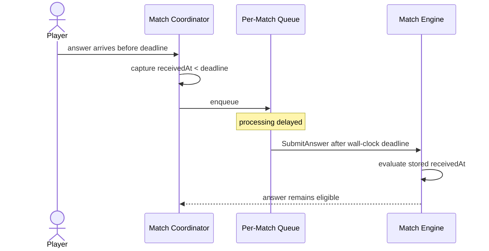

Exclusive deadline: `receivedAt < openedAt + 10_000 ms`. Client timestamps and Engine processing time cannot alter eligibility. Network delay before admission is borne by the client; internal processing delay is not. Deadline commands are not admitted early, so eligible admitted answers precede the close barrier.

## 9. Question Deadline Flow

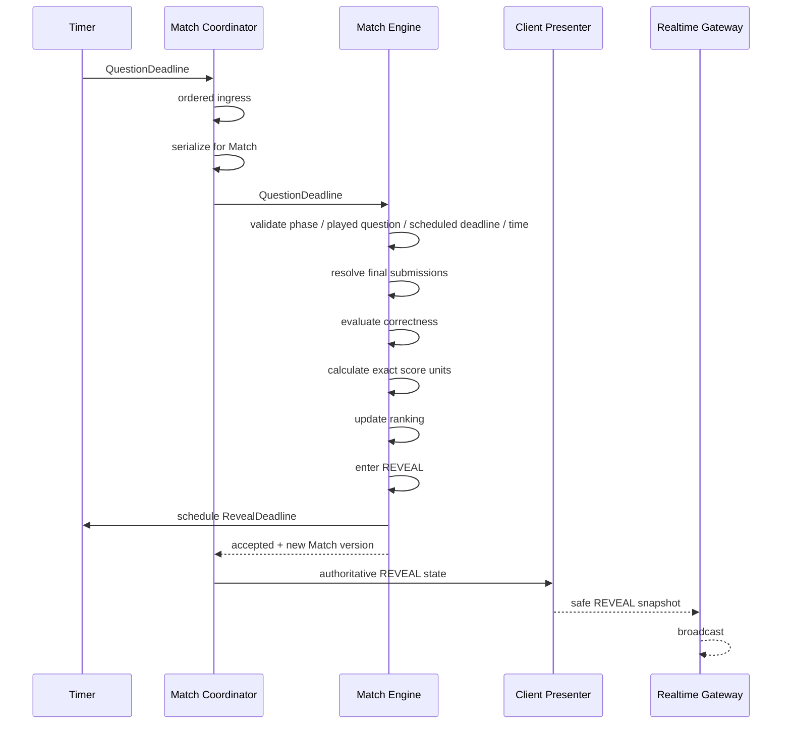

Validate current `QUESTION_OPEN`, played-question/scheduled-deadline identity, and deadline reached. Stale/duplicate timers cannot affect another round. Finalize submissions once; update exact scores/ranks, enter `REVEAL`, schedule its deadline, publish snapshots. Default `earlyClose=false`; enabled early-close policy remains open.

## 10. Scoring Flow

```text
final accepted answer → Engine correctness/time scoring → exact question units
                     → accumulated units → exact ranking/shared ties
```

Engine evaluates final accepted Choice, attempts, and elapsed milliseconds, then accumulates exact units and ranks. Wrong/no answer is zero. Formula/scale authority: [system design §13](system-design.md#13-scoring-and-ranking). No 9-second cutoff, editing penalty subtraction, or authoritative rounding.

## 11. Reveal Flow

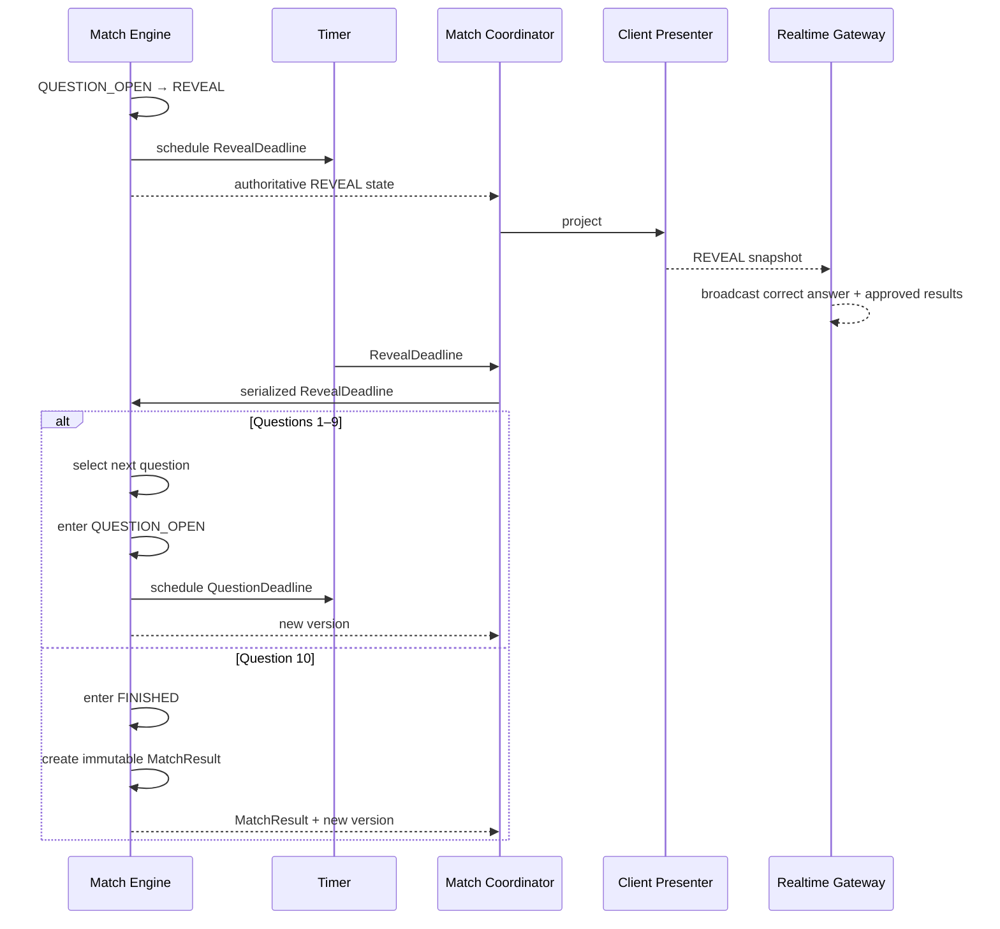

Expose the correct Choice and approved results on entering `REVEAL`; the phase lasts 5 seconds. After reveals 1–9 open the next question; after reveal 10 produce `FINISHED`. Timer callbacks always pass through admission/serialization.

## 12. Match Completion Flow

```text
REVEAL Q10 → RevealDeadline → FINISHED → immutable MatchResult
```

After question 10's reveal, produce one immutable `MatchResult`. Gameplay, scores, ranking, and timer transitions are terminal. Result projection does not claim successful durable persistence before commit.

## 13. Completed Match Persistence Flow

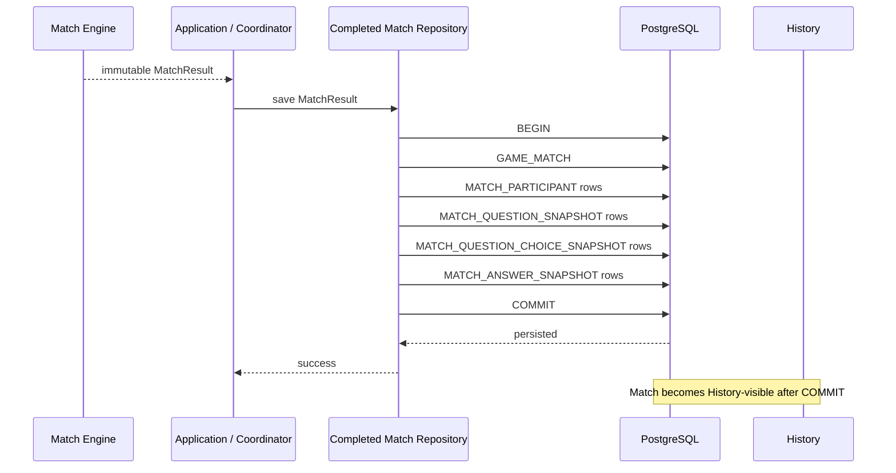

Application—not Engine—owns persistence handoff. One transaction writes the entire validated graph. Match and participation `finished_at` values come from the same `MatchResult.finishedAt`; History-visible only after commit. See [database design §§9–10](database-design.md#9-completed-match-persistence).

## 14. Persistence Failure Flow

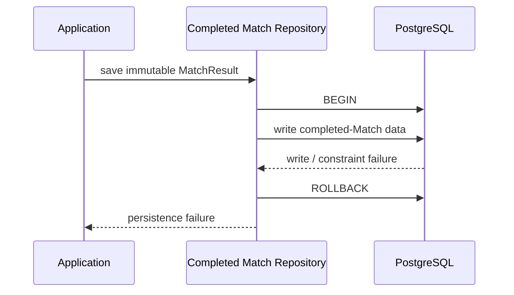

Rollback exposes no partial History and cannot reopen gameplay. Retain immutable result for approved application-level retries; no M1 guarantee of crash delivery between finish and commit.

## 15. Persistence Retry Flow

```text
save result → absent Match: atomic insert
            → existing Match: compare complete result → identical / conflict
```

Compare the complete result for the stable Match identity. Identical retry succeeds idempotently; conflict is an invariant violation. PK/UNIQUE prevent duplicates but blind `ON CONFLICT DO NOTHING` does not prove equivalence.

## 16. History List Flow

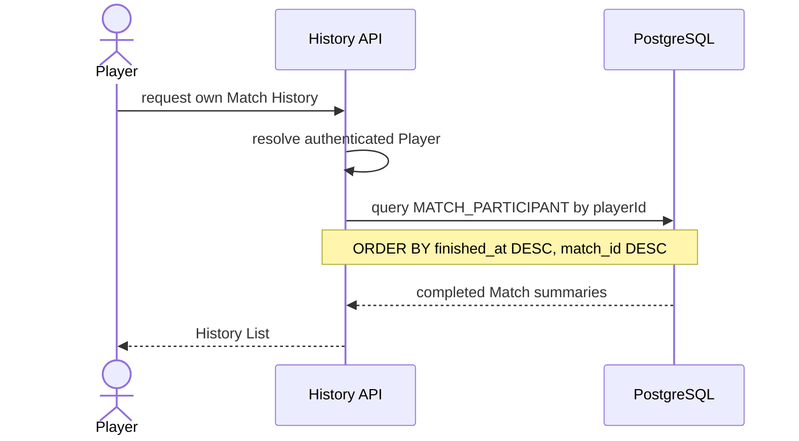

Read own committed participations using `(player_id, finished_at DESC, match_id DESC)` and SQL LIMIT, with own score/rank and participant count. External cursor contract and stored-versus-derived count remain open.

## 17. History Detail Flow

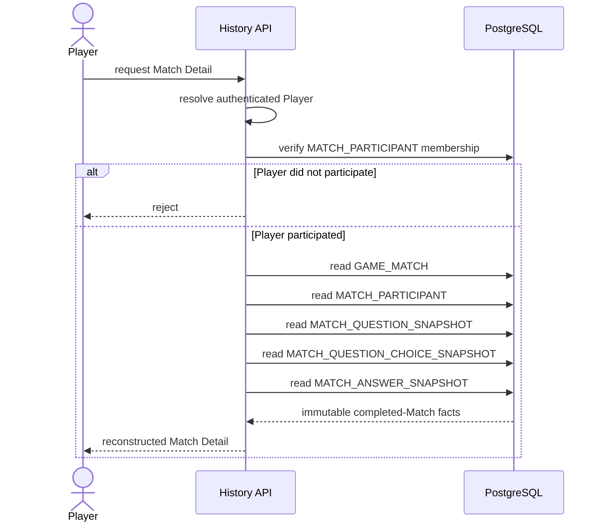

Participation authorization precedes returning Detail. Reconstruct summary, final scoreboard, ordered questions/Choices, correct Choice, and requesting Player's final results from immutable snapshots; no mutable Question Bank read.

## 18. End-to-End Critical Path

```text
Authenticate Host → Create → Authenticate/join second Player → Host START
→ (QUESTION_OPEN → submissions → deadline → REVEAL) × 10
→ FINISHED / MatchResult → atomic persistence → COMMIT → History List / Detail
```

Primary M1 integration path. Gameplay finish and durable commit are distinct; FINISHED projections do not imply History visibility until persistence succeeds.

## 19. Authority Summary

See [component ownership summary](HLD_Component_Diagram.md#22-component-ownership-summary). Only Engine mutates active Match state; Coordinator orders; Timer schedules; Presenter projects; PostgreSQL stores committed facts.
