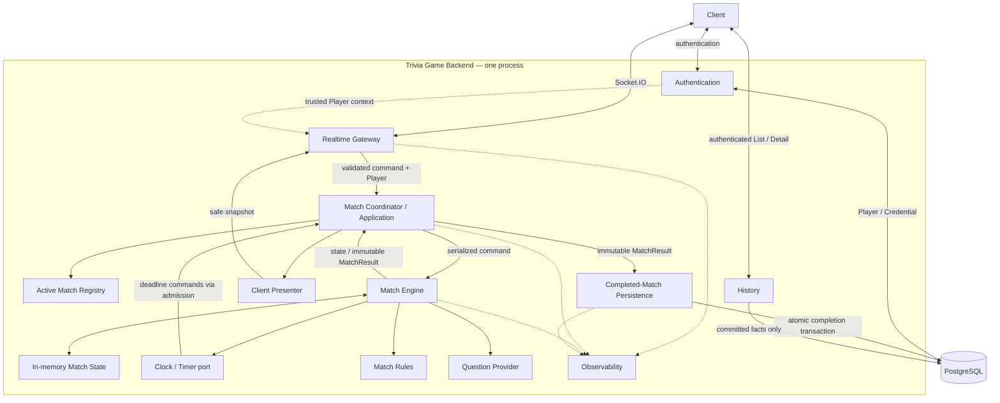
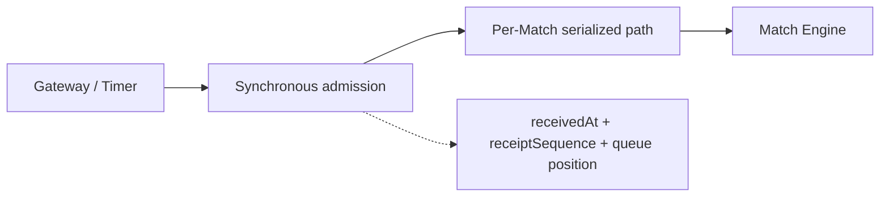
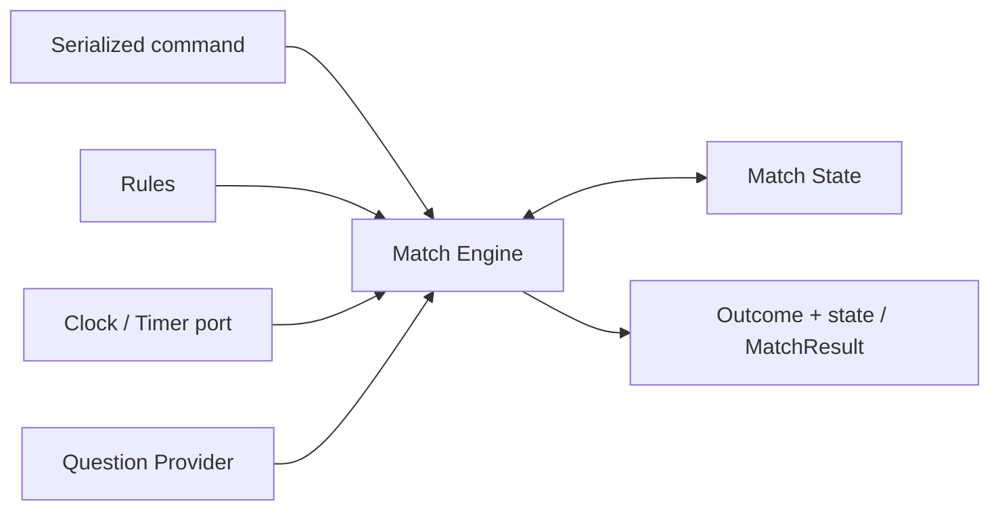
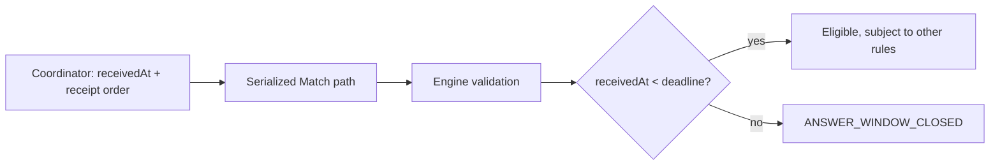

# Trivia Game HLD Component Diagram

Status: M1 design baseline. Authority: [system design](system-design.md).
Runtime contracts: [LLD](low-level-design.md). Durable constraints: [database design](database-design.md).
Critical sequences: [data flows](Data_Flow_Diagram.md).



Arrows show runtime collaboration, not framework imports. The Engine uses ports and
returns state/results; it does not call a PostgreSQL adapter or mutate transport state.

## 1. Architecture Boundary

Modular monolith: one backend process, PostgreSQL, and 2–10 clients per Match.
One in-memory owner per active Match; no Redis, broker, distributed coordination,
or active-Match persistence/restart recovery in M1.

## 2. Runtime Command Path

```text
Client → Gateway ─┐
Timer ────────────┴─> Coordinator → Engine → Match State
                          ├── Presenter → Gateway → Client
                          └── FINISHED result → Persistence
```

## 3. Realtime Gateway

Connections, transport validation, trusted Player context, ACK delivery, snapshot
delivery. No gameplay rule, timing, score, ranking, or state-mutation authority.

## 4. Match Coordinator



Own registration/lookup, routing, non-yielding FIFO admission, serialization,
idempotency, projection dispatch, and completion handoff. Do not duplicate domain rules.
Different Matches execute independently.

## 5. Active Match Registry

Process-local `matchId → authoritative execution context`. Lookup only, not durable
storage or an independent mutation authority.

## 6. Match Engine



Validate and mutate gameplay: Host-only Start, participant bounds, progression,
deadline eligibility, submissions/attempts, scoring/ranking, terminal result.
Only the Engine mutates Match State; no bot/tournament branches or infrastructure imports.

## 7. Match State

In-memory aggregate: Host, participants, Rules, phase, played questions, submissions,
deadlines, exact score units, ranking, version, terminal result.
Operational queue/idempotency/timer handles belong to the execution context,
not durable History.

## 8. Timer / Clock

Provide authoritative time and schedule Question/Reveal deadline commands.
Callbacks return through Coordinator admission; never mutate state directly.
Current phase, question/deadline identity, and time validation protect against
stale/duplicate timers. Cancellation alone is not correctness.

## 9. Match Rules / Configuration

Initial: 10 questions, 10-second maximum answer window, 5-second reveal,
answer changes enabled, maximum 3 attempts, `earlyClose=false`.
`earlyClose=true` is a configurable capability with an unresolved policy; do not
enable it or assume all-answered immediate close. Rules do not identify tournaments.

## 10. Question Provider

Deterministic/in-memory question identity, text, ordered Choices, and private correct
Choice. No ownership of progression, participant state, score, or ranking.
Persistent Question Bank authoring/versioning is outside M1.

## 11. Client Presenter

```text
private state + viewer → Presenter → phase-safe versioned snapshot → Gateway
```

No mutation. Hide answer keys and answer-revealing evaluation state before
`REVEAL`; use viewer-specific projections. Clients replace only with newer versions.

## 12. Authentication

Username/password credential → secure hash verification → durable Player context.
Player identity is neither username nor socket identity. Gameplay and History use
Player IDs. No email verification, OAuth, MFA, or recovery in M1.

## 13. Persistence

```text
Engine FINISHED → immutable MatchResult → Application → Persistence → PostgreSQL
```

Write Match, participants, question/Choice snapshots, and all final answer results
atomically. History-visible only at commit. Identical result retry succeeds;
same identity with conflicting content fails. No active-game authority.

## 14. PostgreSQL

Durable Player/credential records and immutable completed snapshot graph.
Schema/constraints/indexes are defined once in [database design](database-design.md).
PostgreSQL is not authoritative for live timing, scoring, ranking, or transitions.

## 15. History

Authenticated own List; Detail requires requesting Player's participation.
List access: `(player_id, finished_at DESC, match_id DESC)`.
Detail reconstructs bounded immutable snapshots, not current Question Bank content.
Cursor contract, stored participant count, permanent source lineage remain open.

## 16. Observability

Non-blocking diagnostics for command identity/outcome, Match phase/version,
ingress sequence/time, deadline, transitions, and persistence failures.
Never log credentials, secrets, unnecessary private data, or pre-reveal answer keys.

## 17. Scoring Boundary

Engine-only exact scoring/ranking: scale 3,000,000 units/point; authoritative elapsed
integer milliseconds; at most 3 attempts. See [system design §13](system-design.md#13-scoring-and-ranking).
Persist integer units; JSON carries decimal strings. Formatting cannot change ties.

## 18. Deadline Authority



Exclusive 10-second hard deadline. No client-clock authority or processing-time penalty.
Admit timers only at/after deadline; already-admitted earlier answers precede the close
barrier. Internal scheduling delay cannot change their eligibility.

## 19. Dependency Direction

```text
Transport → Application / Coordination → Domain → Ports ← Infrastructure adapters
```

Socket.IO, NestJS, PostgreSQL, and scheduling implementations stay outside the domain.

## 20. Explicit Non-Components

No Redis/broker, distributed lock/coordinator, Bot Controller, Tournament Service,
public matchmaking, chat, active-recovery/event store, or durable gameplay queue in M1.

## 21. Future Extension Boundaries

```text
Human client ───────────┐
Future Bot Controller ─┴─> same gameplay commands → Coordinator → Engine

Future Tournament Orchestrator → create/configure Matches → MatchResult → orchestrator
```

Match knows neither bot nor tournament orchestration. No replacement bot on lobby leave.
Distributed scaling requires a design update preserving one owner/Match, ordered
ingress, serialization, deadlines, and idempotency. Infrastructure is requirement-driven.

## 22. Component Ownership Summary

| Concern | Owner |
|---|---|
| Credentials / authentication | Authentication with PostgreSQL |
| Connections / transport validation / delivery | Gateway |
| Lookup / ingress metadata / serialization / idempotency / handoff | Coordinator |
| Membership / phases / deadlines / attempts / scoring / version / result | Engine |
| Active aggregate | Engine-owned Match State |
| Scheduled callbacks | Timer; execution through Coordinator |
| Content / private key | Question Provider |
| Viewer-safe projection | Presenter |
| Atomic durable completion | Persistence |
| Authorized committed reads | History |
| Diagnostics | Observability |

## 23. Final Architecture

One Engine owns each active Match. Gateway transports; Coordinator orders and hands
off; Engine decides/mutates; Presenter projects; Persistence commits; History reads.
The main diagram is the canonical component view; sequences are in the data-flow document.
