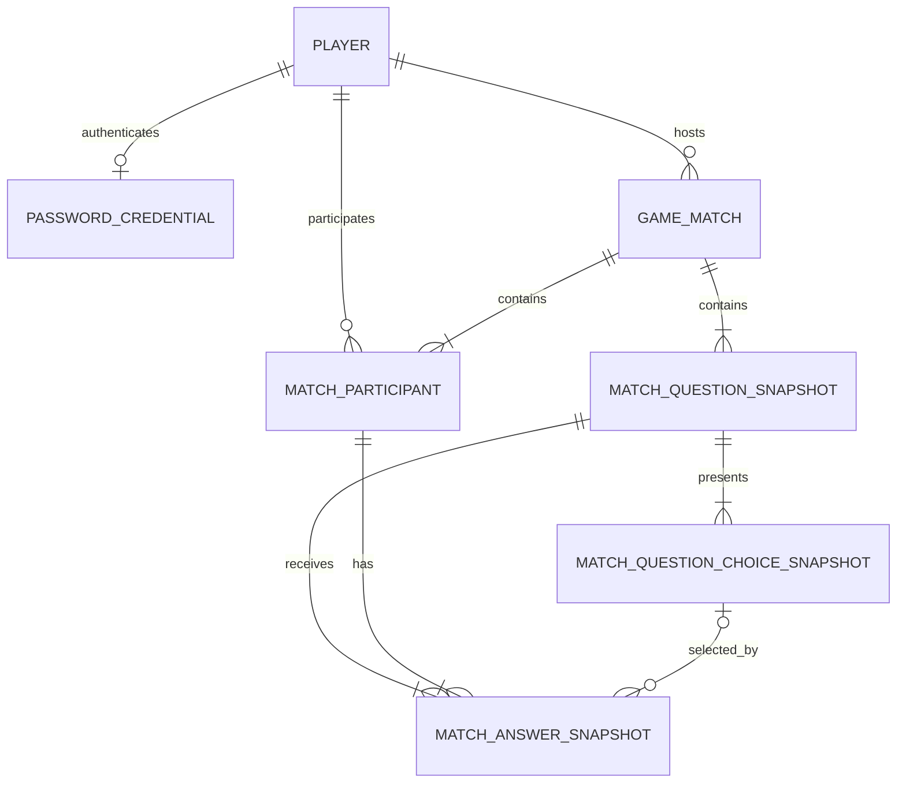

# Trivia Game Database Design

Status: M1 database design baseline. Architectural authority: [system design](system-design.md).
This document owns durable fields, relational constraints, and read access paths;
runtime/protocol contracts belong in the [LLD](low-level-design.md).

PostgreSQL stores Player identity, credentials, and immutable completed History.
It does not coordinate active Matches or persist phase, deadlines, timers, queues,
connections, command-idempotency caches, or in-progress Submissions for recovery.

## 1. Design Principles

- Player identity is durable and distinct from username, display name, and connection identity.
- Credentials resolve to a Player; gameplay and History reference only Player identity.
- One immutable `MatchResult` supplies all completed facts; one transaction commits them.
- Historical question/Choice content is self-contained, not a join to mutable source content.
- Scores are exact integer units; presentation decimals are not authoritative.
- Add indexes only for approved, demonstrated access patterns.

## 2. Persistent Data Model

| Concern | Tables |
|---|---|
| Identity/authentication | `PLAYER`, `PASSWORD_CREDENTIAL` |
| Completed summary/results | `GAME_MATCH`, `MATCH_PARTICIPANT` |
| Content as played | `MATCH_QUESTION_SNAPSHOT`, `MATCH_QUESTION_CHOICE_SNAPSHOT` |
| Final participant/question results | `MATCH_ANSWER_SNAPSHOT` |

## 3. Entity Relationship Diagram



Cardinality bounds and complete question/result coverage are validated at completion
(§5); diagram cardinalities alone do not enforce them.

## 4. Tables

Logical names/keys below are contracts, not production migration SQL.
Unless explicitly nullable/optional, listed durable fields are required (`NOT NULL`).
Player and Match IDs, and foreign keys referencing them, use PostgreSQL `UUID`.
Completed timestamps use `TIMESTAMPTZ(3)` with authoritative Engine milliseconds.
Source-lineage identifier types and deletion/retention policies remain unfrozen.

### 4.1 PLAYER

```text
id               UUID, PK
display_name     required presentation text
```

Stable identity across authentication sessions. Display name is not login username.
The trusted server generates Player IDs; application boundaries represent them as
validated opaque strings.

### 4.2 PASSWORD_CREDENTIAL

```text
player_id        UUID, PK, FK → PLAYER(id)
username         canonical ASCII lowercase, UNIQUE, required
password_hash    required
```

Relationship: one Player has zero or one password credential.
When provisioning a Player together with a password credential, both rows commit
atomically or neither does. A Player may exist without a password credential.
Usernames use ASCII letters/digits/underscore/hyphen/period, 1–128 UTF-8 bytes;
authentication and uniqueness are case-insensitive through lowercase canonical
storage. Migration 002 checks legacy collisions/invalid values transactionally,
then canonicalizes and adds a CHECK constraint while retaining UNIQUE(username).
It never merges/deletes accounts or changes migration 001/Player UUIDs. Player
provisioning validates Unicode display names at 1–64 extended grapheme clusters,
rejecting blank/unsafe controls without trimming stored input. Legacy display rows
remain untouched; no incompatible ICU-dependent SQL constraint is introduced.
Process-local sessions add no durable table. Stage 2.5 self-registration reuses these
existing tables/transaction without a new migration. Public password creation requires
15 Unicode code points minimum and 1024 UTF-8 bytes maximum without normalization,
composition rules or a blocklist; legacy Login stays unchanged. See [API §2.2](api-contract.md#22-self-registration-stage-25).

Store secure password hashes, never plaintext. Gameplay/History does not join
credentials for identity. Email, OAuth, MFA, recovery, and generic credential
linking are outside M1.

### 4.3 GAME_MATCH

```text
id               UUID, PK
host_player_id   FK → PLAYER(id)
started_at       TIMESTAMPTZ(3), required
finished_at      TIMESTAMPTZ(3), required, immutable completion time
```

Only completed Matches are stored. Require `started_at < finished_at`.
Host membership is a cross-row invariant (§5); no active phase belongs here.

### 4.4 MATCH_PARTICIPANT

```text
match_id         FK → GAME_MATCH(id)
player_id        FK → PLAYER(id)
finished_at      required
final_score_units BIGINT, required, >= 0
final_rank       required, >= 1
PK (match_id, player_id)
```

One Player's final result in one Match. `finished_at` deliberately duplicates
`GAME_MATCH.finished_at` for chronological Player History; both must come from the
same `MatchResult.finishedAt` in the same transaction, not independently generated
defaults. Equal final units share rank.

### 4.5 MATCH_QUESTION_SNAPSHOT

```text
match_id             FK → GAME_MATCH(id)
question_position    required, BETWEEN 1 AND 10
question_text        required, copied as played
correct_choice_key   required, question-local Choice
source_question_id?  optional lineage; retention not decided
PK (match_id, question_position)
```

The required correct Choice must identify a Choice in this same snapshot:

```text
FK (match_id, question_position, correct_choice_key)
 → MATCH_QUESTION_CHOICE_SNAPSHOT(match_id, question_position, choice_key)
```

The question→correct Choice and Choice→question references form a cycle.
The final SQL/write plan must satisfy both at commit (for example via deferred
checking) without accepting an invalid committed result.
No separate correct-Choice flags are needed to represent the single correct key.

### 4.6 MATCH_QUESTION_CHOICE_SNAPSHOT

```text
match_id
question_position
choice_key          required, local to this played question
display_order       required
choice_text         required, copied as presented
source_choice_id?   optional lineage; retention not decided
PK (match_id, question_position, choice_key)
FK (match_id, question_position)
 → MATCH_QUESTION_SNAPSHOT(match_id, question_position)
UNIQUE (match_id, question_position, display_order)
```

Order by `display_order` to reproduce presentation. Number of Choices is not frozen.
Source IDs never determine membership or historical content.

### 4.7 MATCH_ANSWER_SNAPSHOT

```text
match_id
question_position
player_id
selected_choice_key nullable
attempt_count       required, 0..3
final_answered_ms   INTEGER, nullable
question_score_units BIGINT, required, >= 0
PK (match_id, question_position, player_id)

FK (match_id, player_id)
 → MATCH_PARTICIPANT(match_id, player_id)
FK (match_id, question_position)
 → MATCH_QUESTION_SNAPSHOT(match_id, question_position)
FK (match_id, question_position, selected_choice_key)
 → MATCH_QUESTION_CHOICE_SNAPSHOT(match_id, question_position, choice_key)
```

The nullable selected-Choice relationship must allow a valid no-answer row
without weakening answered-row membership checks.

Required answered/no-answer check:

```sql
CHECK (
    (selected_choice_key IS NULL
     AND attempt_count = 0
     AND final_answered_ms IS NULL
     AND question_score_units = 0)
    OR
    (selected_choice_key IS NOT NULL
     AND attempt_count BETWEEN 1 AND 3
     AND final_answered_ms IS NOT NULL
     AND final_answered_ms >= 0
     AND final_answered_ms < 10000
     AND question_score_units >= 0)
)
```

One final result per participant/question, including explicit no-answer rows.
Persist the awarded score; never recalculate History from current source content.

## 5. Relationship Invariants

Validate the immutable completed result before commit in addition to SQL constraints:

- 2–10 participants; Host belongs to that Match; no duplicate Player.
- Exactly ten played questions with the complete position set 1..10.
- Presented Choice order is deterministic and correct Choice belongs to that question.
- Each participant has one final result for every played question (at most 100 rows).
- Each answered result selects a Choice in its own question; participant belongs to Match.
- Wrong/no-answer scores are zero; correct scores follow system design §13.
- Participant final units equal the sum of persisted question units.
- Ranking follows descending exact totals; equal totals share rank, including co-winners.
- Match and all participant completion timestamps are identical.

Do not add triggers merely to encode cross-row gameplay invariants.
PK/UNIQUE constraints enforce duplicate prevention; do not add redundant UNIQUE
constraints for the same columns as a PK.

## 6. NULL Semantics

PostgreSQL `CHECK` permits an expression evaluating to `NULL`.
Use required-field `NOT NULL` constraints plus the explicit answered/no-answer
branches in §4.7; `final_answered_ms < 10000` alone is insufficient.
Optional source lineage and unanswered Choice/time are intentionally nullable.

## 7. Score Representation

Scoring authority: [system design §13](system-design.md#13-scoring-and-ranking).

| Value | PostgreSQL representation |
|---|---|
| Elapsed authoritative ingress time | `final_answered_ms INTEGER`, answered range 0..9999 |
| Awarded question score | `question_score_units BIGINT` |
| Accumulated final score | `final_score_units BIGINT` |

Scale is 3,000,000 units/point. No authoritative rounding or floating-point conversion.
Current maxima: 60,000,000 units/question; 600,000,000 units/ten-question Match.
Equality, ordering, and shared ranking operate directly on exact integer units.
PostgreSQL `SUM(BIGINT)` returns exact `NUMERIC`; any cast back must respect bounds,
never pass through floating point. JSON uses decimal strings for exact score units.

Changes to scoring denominators, attempts, timing precision, question count, or score
bounds require revalidating scale and integer bounds.

## 8. Access Patterns and Indexes

### 8.1 Authentication

Username lookup uses its UNIQUE-created index; Player/profile lookup uses the Player PK.
No additional authentication index is required. PostgreSQL creates indexes for
PK/UNIQUE, not automatically for foreign keys.

### 8.2 Player History List

```text
WHERE player_id = authenticated Player
ORDER BY finished_at DESC, match_id DESC
LIMIT requested bounded page
```

Approved additional access path:

```text
MATCH_PARTICIPANT (player_id, finished_at DESC, match_id DESC)
```

Return Match identity, completion time, own score/rank, and participant count.
Chronological lookup uses participation rows directly; enrich only as needed.
Do not load all History into application memory. Equal timestamps are ordered by Match ID.
Slice 6 uses the LLD §5.7 keyset contract (default 20, maximum 50, limit + 1
look-ahead); the cursor is a seek position, not a cross-request snapshot.

### 8.3 Match History Detail

Authorize requesting Player using `MATCH_PARTICIPANT(match_id, player_id)` before
returning any Detail. Read Match summary, final scoreboard, ten questions ordered by
position, Choices ordered by presentation order, correct Choice, and own answer results.

Match-prefixed PK/UNIQUE indexes serve this bounded graph; no additional Detail-specific
index is currently justified. Detail reads snapshots only, never mutable Question Bank rows.

### 8.4 Participant Count

Can be derived with `MATCH_PARTICIPANT WHERE match_id = ?`.
Slice 6 derives this count only for the bounded returned page; no stored count is added.

## 9. Completed-Match Persistence

### 9.1 Source of Persistence

Engine `FINISHED` produces one immutable `MatchResult`. Application/persistence
consumes it; do not reconstruct completion from later mutable runtime/source reads.

### 9.2 Completion Transaction

```text
BEGIN
  validate completed-result invariants
  GAME_MATCH
  MATCH_PARTICIPANT × N
  MATCH_QUESTION_SNAPSHOT × 10
  MATCH_QUESTION_CHOICE_SNAPSHOT × presented Choices
  MATCH_ANSWER_SNAPSHOT × N × 10
COMMIT → History-visible
```

Any required write/validation failure rolls back the whole result.
Respect composite FK dependencies, including the correct-Choice cycle.

### 9.3 Shared Completion Timestamp

Copy the same immutable `MatchResult.finishedAt` to Match and every participation row.

### 9.4 Historical Immutability

No normal gameplay updates completed facts, content, awarded scores, or ranks.
Persistence failure cannot reopen the `FINISHED` Match.
Retain the immutable result for approved application-level retry behavior; crash
recovery between finish and commit is not an M1 guarantee.

## 10. Persistence Retry Semantics

```text
same matchId + identical complete result → idempotent success
same matchId + conflicting result       → invariant violation
```

Compare the complete persisted result, not just its summary or existence.
PK/UNIQUE constraints prevent duplicates but cannot prove equivalent content.
Blind `ON CONFLICT DO NOTHING` is not a correct retry policy.
Concurrent/ambiguous retries must preserve atomicity and conflict detection.

## 11. Historical Snapshot Semantics

Persist question text, presented Choice text/order, correct Choice, and final
participant/question outcomes as played. Source edits/deletion cannot change History.
Source identifiers, if retained, are lineage only; never required joins.

## 12. Active State Is Not Persisted

Runtime-only state is listed in the introduction. M1 process failure may lose active
Matches; committed identity/History remains durable. Completed persistence does not
imply active-Match restart recovery or guaranteed finish-to-commit crash delivery.

## 13. Question Bank Boundary

M1 uses deterministic/in-memory questions, not a persistent authoring/versioning model.
Future source schema, lifecycle, and FK policy cannot weaken immutable snapshots.

## 14. Data Ownership Summary

Authentication/persistence owns credentials and durable Player records.
Completed History owns committed Match summary, participants, and snapshot facts.
Only the Match Engine mutates authoritative live gameplay.

## 15. Open and Deferred Database Decisions

- Source-lineage identifier representations and retention/deletion policies;
  Player/Match UUIDs and dependent composite keys are approved for Slice 5.
- History HTTP cursor/limits/error metadata and derived participant count are approved
  in LLD §5.7; no additional schema or index is required for Slice 6.
- Permanent source Question/Choice lineage and any future source FK policy.
- Question Bank authoring, versioning, deletion, and audit workflow.
- Active-Match recovery is outside M1; adding it requires a system-design update.

These are not permissions to invent policies during implementation.

## 16. Database Guardrails

No Redis as durable truth, active-state/event-log persistence, outbox/workers,
speculative indexes, gameplay-progression triggers, database-authoritative scoring,
floating-point scores, or mutable-source History reconstruction.
Infrastructure/topology changes require architectural approval.

## 17. Final Schema Overview

```text
PLAYER ── 0..1 PASSWORD_CREDENTIAL
  ├── hosts ─────────────────────> GAME_MATCH
  └── participates ──> MATCH_PARTICIPANT
                           │           │
                           │           └── GAME_MATCH
                           │                 └── MATCH_QUESTION_SNAPSHOT
                           │                       ├── CHOICE_SNAPSHOT
                           └───────────────────────└── ANSWER_SNAPSHOT
```

Authoritative in-memory Match → immutable result → validated transaction → commit
→ self-contained, immutable participant-authorized History.
