# Trivia Game Low-Level Design

> **Status:** Draft  
> **Upstream:** `docs/system-design.md`

This document translates the approved system design into implementation-level
domain models, component boundaries, interfaces, runtime flows, data models,
and correctness rules.

`system-design.md` is authoritative for requirements and architecture.
This document must not contradict it. Open or deferred decisions must not be
invented during implementation.

## 1. Scope & Context

### Baseline

- Modular monolith with server-authoritative gameplay.
- One authoritative in-process owner per active Match.
- Same-Match commands are serialized.
- Player and timer commands use the same authoritative command path.
- Socket.IO is the initial realtime transport.
- PostgreSQL stores approved durable data; it does not own active Match state.
- No Redis, broker, distributed coordination, or active-Match restart recovery
  unless required by an updated system design.

### Scope

This LLD defines:

- domain model and Match state machine;
- component responsibilities and interfaces;
- commands, realtime contracts, and critical runtime flows;
- concurrency, deadline, idempotency, and versioning rules;
- runtime and persistent data models;
- validation/error behavior and test boundaries.

Deferred functionality remains deferred as defined by `system-design.md`.

If implementation requires changing an architectural assumption, update the
design first rather than silently changing it in code.

---

## 2. Domain Model

### 2.1 Domain Overview

`Match` is the authoritative gameplay aggregate. It owns the current phase,
participants, question progression, submissions, scores, ranking, rules, and
state version.


Only the Match Engine may mutate gameplay state through the serialized Match path.

---

### 2.2 Match

**Responsibility**

Represents one complete quiz session from lobby creation through completion.

A Match owns:

- phase and lifecycle;
- Host and current participants;
- question progression;
- accepted submissions;
- accumulated scores and ranking;
- Match rules;
- authoritative deadlines relevant to gameplay; and
- state version.

**Invariants**

- A Match contains 2–10 participants when gameplay starts.
- Only the Host may start a Match.
- A Match contains exactly 10 gameplay questions.
- Only valid commands for the current phase may mutate state.
- Commands affecting a Match are applied serially.
- A finished Match is immutable.
- Every actual state mutation advances the Match version; rejection and no-op do not.
- The Match does not contain tournament, bot, transport, or persistence logic.

---

### 2.3 Participant

A `Participant` represents one player participating in a Match.

It contains the identity required by Match gameplay and the participant's
current accumulated score.

The Host is a participant identified by `Match.hostPlayerId`; Host is not a separate
participant type.

During `WAITING`, a departing non-Host participant is removed from the Match.
Active-game disconnect/leave semantics remain deferred to the system design.

A Match must not contain the same participant more than once.

---

### 2.4 Question & Choice

A `Question` represents one single-choice multiple-choice question.

Each Question contains:

- a stable question ID;
- question text;
- available Choices; and
- the correct Choice as private authoritative data.

A `Choice` contains a stable choice ID and display text.

Question/Choice command identities distinguish played occurrences; source IDs,
if retained, are separate lineage. Choice order is part of presented content.

The correct Choice must never appear in a `QUESTION_OPEN` client projection.
Private Question data remains server-side until the current phase permits it
to be revealed.

---

### 2.5 Submission

One current Submission per Player/played question records:

- selected Choice;
- `attemptCount: 1 | 2 | 3`;
- `finalAnsweredMs`, authoritative elapsed ingress time in integer milliseconds.

Accept only for a participant, the current `QUESTION_OPEN` question, a valid
Choice, and `0 <= finalAnsweredMs < 10_000`.

| Input | Outcome |
|---|---|
| First accepted Choice | Create Submission, attempt 1; record ingress timing |
| Current Choice, new command ID | Accepted no-op; preserve attempt, timing, score, version |
| Different Choice, attempt < 3 | Replace Choice; increment attempt; replace final ingress timing |
| Different Choice, attempt = 3 | `MAX_ATTEMPTS_EXCEEDED`; no mutation |
| Processed duplicate command ID | Return established outcome; no execution |

Validate phase, membership, question, Choice, and deadline before the no-op/attempt
branches. A same-Choice submission arriving too late is not an accepted no-op.
A rejected fourth attempt preserves the existing Submission and Match version.

### 2.6 Score & Ranking

Use exact integer units: `SCORE_UNITS_PER_POINT = 3_000_000`.

```text
correctnessUnits = {1: 30_000_000, 2: 15_000_000, 3: 10_000_000}[attemptCount]
speedUnits = (10_000 - finalAnsweredMs) * 3_000
questionScoreUnits = correct ? correctnessUnits + speedUnits : 0
finalScoreUnits = sum(questionScoreUnits)
```

No answer scores zero. No authoritative rounding occurs; binary floating point and
formatted decimal scores never determine equality or ranking.
Rank by exact accumulated units; exact ties share rank, including co-winners.
There is no 9-second cutoff or per-change subtraction.
See [system design §13](system-design.md#13-scoring-and-ranking) for the scoring authority.

### 2.7 Match Rules

`MatchRules` contains Match-level behavior that may vary without changing the
core Match model.

Initial rules include:

- exactly 10 questions;
- answer changes are allowed, with at most 3 accepted attempts;
- question answer window is 10 seconds;
- reveal duration is 5 seconds;
- `earlyClose = false` by default.

The hard 10-second deadline remains the maximum answer window.

The behavior of `earlyClose = true` remains unresolved and must not be
invented during implementation.

Rules describe Match behavior only. They must not introduce dependencies on
future concepts such as tournaments.

---

### 2.8 Domain Relationships

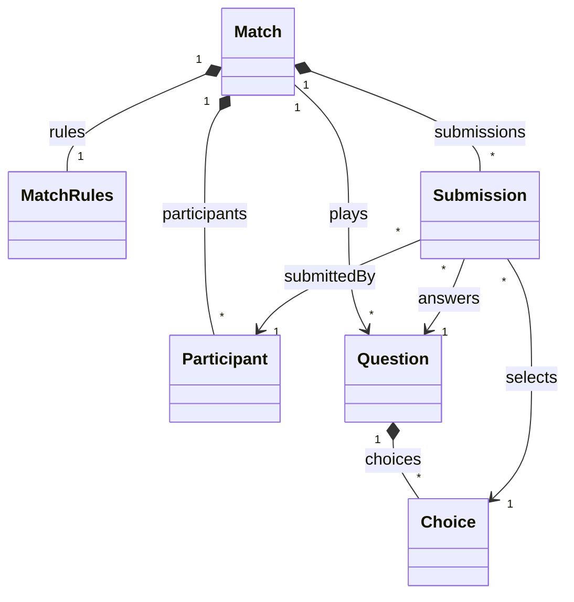

`Match` is the aggregate boundary. `Question` content may originate outside
the Match, but the Match Engine is authoritative for how that content
participates in gameplay.

---

### 2.9 Domain Invariants Summary

The following invariants are correctness-critical:

- Active Match state has one authoritative owner.
- Same-Match state mutations are serialized.
- Gameplay starts only with 2–10 participants.
- Only the Host may start.
- Answers are accepted only during `QUESTION_OPEN`.
- `< 10.000s` is accepted; `>= 10.000s` is late.
- The latest accepted answer is the final answer.
- First accepted Choice is attempt 1; different accepted Choices increment to at most 3.
- Same-Choice resubmission is a no-op; a fourth different Choice is rejected.
- Scoring uses exact integer units with scale 3,000,000.
- Scores are accumulated without per-question rounding.
- Exact score ties share rank.
- Correct-answer data is not exposed before reveal.
- Finished Matches cannot mutate.

## 3. Match State Machine

### 3.1 States

- `WAITING` — participants may join or leave; the Host may start the Match.
- `QUESTION_OPEN` — the current question accepts submissions.
- `REVEAL` — submissions are closed and the resolved question is revealed.
- `FINISHED` — the Match is complete and immutable.

### 3.2 State Transitions

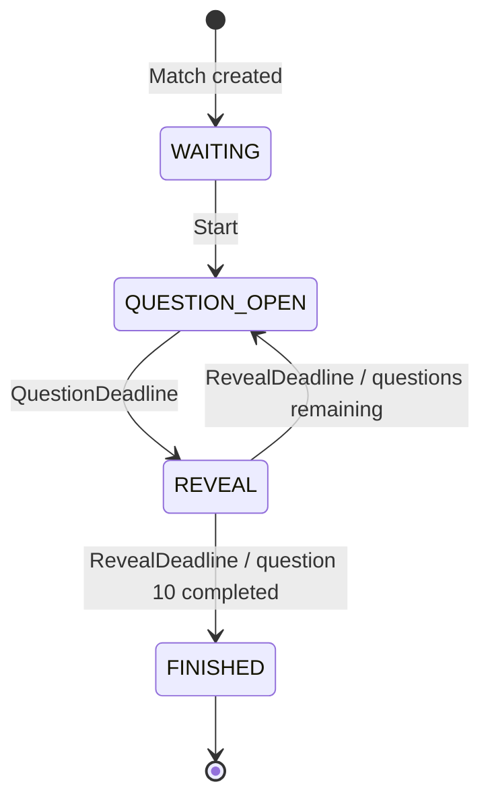

All transitions occur through the authoritative serialized Match command path.

### 3.3 Commands Allowed by State

| State | Command | Allowed | Notes |
|---|---|---:|---|
| `WAITING` | Join | Yes | Up to 10 participants |
| `WAITING` | Leave | Yes | Non-Host behavior defined; Host leave remains unresolved |
| `WAITING` | Start | Yes | Host only; requires 2–10 participants |
| `QUESTION_OPEN` | SubmitAnswer | Yes | Includes first answer and answer changes |
| `QUESTION_OPEN` | QuestionDeadline | Yes | Internal timer command |
| `REVEAL` | RevealDeadline | Yes | Internal timer command |
| `FINISHED` | Any mutation | No | Terminal state |

Commands not listed for the current state are invalid.

### 3.4 Transition Preconditions

`WAITING → QUESTION_OPEN`

- command is issued by the Host;
- current participant count is 2–10.

`QUESTION_OPEN → REVEAL`

- the authoritative question deadline is reached and processed;
- `earlyClose=true` behavior remains unresolved.

`REVEAL → QUESTION_OPEN`

- the 5-second reveal period has completed;
- fewer than 10 questions have been completed.

`REVEAL → FINISHED`

- the 5-second reveal period for question 10 has completed.

### 3.5 Invalid Transitions

Invalid commands are rejected without mutating Match state or advancing its
version.

State validation remains authoritative for delayed, duplicated, or stale
commands.

Examples:

```text
Start          during QUESTION_OPEN → reject
SubmitAnswer   during WAITING       → reject
SubmitAnswer   during REVEAL        → reject
SubmitAnswer   during FINISHED      → reject
```

### 3.6 Terminal-State Rules

`FINISHED` is terminal.

After entering `FINISHED`:

- gameplay state cannot mutate;
- submissions cannot be accepted;
- scores and rankings cannot change;
- timer commands cannot cause further transitions.

The final Match result represents the immutable outcome of the Match.

## 4. Component Design

### 4.1 Component Relationships

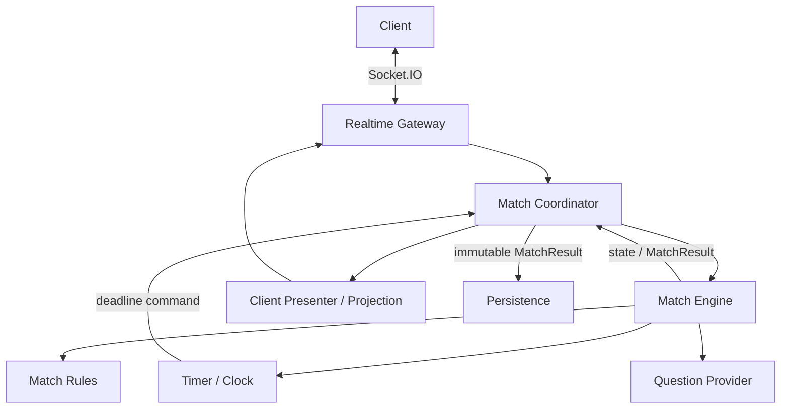

The `Match Coordinator` owns active Match lookup, execution, and command
serialization.

The `Match Engine` is the only component allowed to mutate authoritative
Match state.

No other component may directly mutate active Match state.

---

### 4.2 Realtime Gateway

Validate transport envelopes, resolve authenticated Player context, forward commands,
return ACKs, and deliver safe projections. No gameplay authority or ingress timestamp
assignment: the Coordinator admits commands atomically.

### 4.3 Match Coordinator

Own active Match registration/lookup, routing, ordered admission, same-Match
serialization, command idempotency, projections, and completion handoff.

```text
Gateway / Timer → Coordinator → per-Match FIFO path → Engine
```

Capture `receivedAt`, `receiptSequence`, and queue position synchronously without
yielding. Different Matches execute independently. Processed retries return their
established outcomes. Match-command retries use `(matchId, playerId, commandId)`;
Create retries use a separate `(playerId, commandId)` namespace. In-flight
duplicates share the established operation; completed duplicates replay the
original receipt without re-execution. Retain completed Match aggregates and
cached outcomes in process until shutdown, without TTL or durable restart recovery.
Release idle queue resources and cancel obsolete timers. An execution exception
without an established receipt creates no successful cached outcome; a post-commit
scheduling failure does not invalidate the committed command's accepted receipt.
No payload-conflict policy is implied.

Only the Engine validates Host, phase, membership, attempts, deadlines, and scoring.

### 4.4 Match Engine

Execute domain commands against Match State; validate before mutation.
Produce updated state/command outcome and, at `FINISHED`, one immutable `MatchResult`.
Every actual mutation advances version; rejection and no-op do not.

Dependencies are approved Rules and Clock/Timer/Question Provider ports.
No Socket.IO, NestJS, PostgreSQL transaction, connection, or bot/tournament dependency.

### 4.5 Timer / Clock

```text
now()
schedule(deadline, command)
cancel(scheduleId)
```

Opening a question schedules its hard deadline; entering `REVEAL` schedules a
5-second deadline. Callbacks enter Coordinator admission, never direct mutation.
Do not admit deadline commands before their scheduled time. Stale/duplicate timers
are invalidated by current phase, played-question, and scheduled-deadline checks;
cancellation is an optimization, not the correctness mechanism.
Use a replaceable authoritative Clock for deterministic tests.

When the Engine accepts a phase transition, the Coordinator commits the new
authoritative state before attempting to schedule its next deadline. If scheduling
fails, the committed state and original accepted receipt remain valid; record the
separate infrastructure failure. The Match may stall without a deadline timer.
Do not convert this failure into a domain rejection, roll back the transition,
retry or reset the deadline automatically, or terminate the process solely for
this failure. Ordinary operator-initiated shutdown or shutdown for unrelated
reasons remains possible. Successful-path sequences in Section 6 omit this
exceptional branch; active-Match process-restart recovery remains deferred.

### 4.6 Match Rules

```text
questionCount      = 10
answerWindow       = 10 seconds
revealDuration     = 5 seconds
allowAnswerChanges = true
maxAttempts        = 3
earlyClose         = false
```

Validate configuration at creation. Preserve `earlyClose=false|true` as a capability,
but do not enable `true` until its policy is approved. No all-answered shortcut,
settle timer, or reset-on-change policy is implied.

### 4.7 Question Provider

Supply deterministic in-memory Question content and private answer keys through a
port. Do not own progression or introduce an unapproved selection/authoring policy.
Provider failure must not leave a partially opened question.

### 4.8 Client Presenter / Projection

Read authoritative state for a viewer without mutation; emit phase-safe snapshots.
Never serialize internal state directly. `QUESTION_OPEN` excludes correct Choice,
correctness, other Players' selections, and answer-revealing evaluation fields.
Section 5 defines projections; reconnect policy remains deferred.

### 4.9 Persistence, Authentication & History

| Boundary | Contract |
|---|---|
| Authentication | Verify username/password hash; resolve durable Player identity for HTTP and realtime context |
| Completed-Match repository | Validate and commit immutable `MatchResult` plus complete snapshot graph in one transaction |
| History | Read committed own List and participation-authorized Detail |

Player IDs are server-generated UUIDs represented as validated opaque strings at
application boundaries. Credentials resolve to durable Player identity; password
verification alone does not establish an HTTP or realtime session. Durable-schema
migrations run explicitly outside normal backend startup.

Persistence is required in M1, not optional. Identical retries succeed idempotently;
conflicting results for the same Match identity fail. Neither persistence nor History
mutates active gameplay. See [database design](database-design.md).

---

## 5. Interface & API Design

### 5.1 Interface Conventions

External transport messages and internal domain commands are separate
contracts.

```text
Client
  ↓ Socket.IO message
Realtime Gateway
  ↓ validated + identity-enriched command
Match Coordinator
  ↓ serialized MatchCommand
Match Engine
```

Client input contains only data the client is authoritative for.

The server owns participant identity, receive time, Match state, deadlines,
attempt count, scoring, ranking, and state version.

Transport payloads use JSON. Field names use `camelCase`.

IDs are opaque strings at protocol boundaries.

Deadline timestamps exposed to clients are absolute display timestamps. Internal
eligibility uses the authoritative Clock; `finalAnsweredMs` is integer elapsed
server ingress time. Conversion for display cannot alter eligibility.

Client timestamps, if collected for diagnostics, never determine answer
acceptance or scoring.

---

### 5.2 Realtime Command Envelope

Every retryable client command carries a unique `commandId`.

```ts
interface ClientCommand<TPayload> {
  commandId: string;
  payload: TPayload;
}
```

For commands targeting an existing Match, `matchId` is part of the payload.

`playerId` is not accepted as client authority. The Gateway resolves the
participant identity from trusted connection/session context and attaches it
to the internal command.

Conceptually:

```text
Client message
{
  commandId,
  payload
}
        ↓
Realtime Gateway
        + playerId
        ↓ Coordinator admission
        + receivedAt + receiptSequence + queue position
        ↓
Internal MatchCommand
```

The server owns:

```text
playerId
receivedAt
Match phase
Match version
question deadline
response time
attempt count
score
ranking
correct answer
```

A valid transport payload may still be rejected by application or domain
validation.

Command acknowledgement and authoritative Match state are separate concerns:

```text
Client command
      ↓
Match processing
      ├──→ acknowledgement to sender
      └──→ versioned snapshot to relevant clients
```

The acknowledgement reports the outcome of that command.

Snapshots represent authoritative Match state and are defined in Section 5.5.

---

### 5.3 Client → Server Commands

#### Create Match

Creates a new Match and makes the authenticated Player its Host and first participant.
Player identity/profile comes from trusted server context, not a gameplay payload.
Optional rules must be validated against approved configuration; M1 uses the defaults.

```ts
interface CreateMatchPayload {
  rules?: MatchRulesInput;
}
```

```text
Client
  ↓ CreateMatch
Gateway
  ↓ trusted participant identity
Coordinator
  ↓ create execution context
Engine
  ↓ create Match + Host participant
WAITING
```

The client does not provide:

```text
matchId
hostPlayerId
playerId
phase
version
```

These values are server-owned.

The response exposes the generated Match identity through the acknowledgement
and/or resulting lobby snapshot.

---

#### Join Match

Adds the requesting participant to a Match in `WAITING`.

```ts
interface JoinMatchPayload {
  matchId: string;
}
```

The server resolves `playerId` from trusted connection/session context.

`Join` is rejected when:

- the Match does not exist;
- the Match is not in `WAITING`;
- the participant is already present; or
- the Match already contains 10 participants.

A successful Join mutates participant membership through the Match Engine and
produces a new Match version.

---

#### Leave Match

Requests removal of the current participant from a Match.

```ts
interface LeaveMatchPayload {
  matchId: string;
}
```

The client does not specify which participant to remove.

The participant is derived from trusted connection/session context.

Non-Host departure during `WAITING` removes that participant and produces an
updated lobby snapshot.

Host departure during `WAITING` remains unresolved.

Leave/disconnect behavior after gameplay has started remains unresolved and
must not be invented by the transport layer.

---

#### Start Match

Requests transition from `WAITING` to `QUESTION_OPEN`.

```ts
interface StartMatchPayload {
  matchId: string;
}
```

The Engine accepts the command only when:

- the requester is the Host;
- the Match is in `WAITING`; and
- the current participant count is 2–10.

The client does not provide the question, phase, start time, or deadline.

A successful Start opens question 1 and establishes its authoritative
server-side deadline.

---

#### Submit Answer

Submits the participant's selected Choice for the current question.

The same command is used for both the first answer and subsequent answer
changes.

```ts
interface SubmitAnswerPayload {
  matchId: string;
  questionId: string;
  choiceId: string;
}
```

The client does not provide:

```text
playerId
responseTime
attemptCount
isCorrect
score
deadline
```

The Engine determines those values from authoritative state and server time.

A submission is accepted only when:

- the Match is in `QUESTION_OPEN`;
- the requester is a participant in the Match;
- `questionId` is the current question;
- `choiceId` belongs to that question; and
- authoritative receive time is before the question deadline.

```text
receivedAt < deadline   → eligible
receivedAt >= deadline  → reject as late
```

If no accepted Submission exists for the participant and current question,
the command creates the first Submission with `attemptCount = 1`.

If an accepted Submission already exists with a different Choice, the command
replaces the selected Choice and increments `attemptCount` only if it is below 3;
otherwise reject with `MAX_ATTEMPTS_EXCEEDED`. Accepted changes update
`finalAnsweredMs`; rejected commands preserve it.

The client never declares whether a command is a first submission or an
answer change.

A repeated command with the same `commandId` must not apply the submission
twice.

After phase/identity/question/Choice/deadline validation, selecting the current Choice
is an accepted no-op: attempt count, final elapsed time, score, and version are unchanged.

### 5.4 Internal / System Commands

System commands use the same serialized Match command path as player commands.

```text
Player command ──┐
                 ├─→ Match Coordinator → Match Engine
Timer command ───┘
```

A timer callback is not permission to transition state.

The Engine validates every system command against current authoritative Match
state before applying it.

#### Question Deadline

Signals that the scheduled answer window for a question has reached its
deadline.

Conceptually:

```ts
interface QuestionDeadlineCommand {
  matchId: string;
  questionId: string;
  deadlineAt: ServerTime;
}
```

The command is created by the server when a question is opened and scheduled
through the Timer.

It is valid only when:

- the Match is in `QUESTION_OPEN`;
- `questionId` is still the current question; and
- `deadlineAt` matches the current scheduled deadline; and
- the authoritative question deadline has been reached.

A valid `QuestionDeadline`:

1. closes answer acceptance for the current question;
2. evaluates final accepted submissions;
3. updates scores and ranking;
4. transitions the Match to `REVEAL`;
5. advances the Match version; and
6. schedules the reveal deadline.

A stale or duplicate deadline command must not transition a newer Match state.
Validate the scheduled question/deadline identity, not the mutable Match version:
accepted answers advance that version without invalidating the current timer.

```text
QUESTION_OPEN Q3
      ↓
QuestionDeadline(Q3)
      ↓
    REVEAL Q3
```

If an answer command and the deadline command are concurrently ready, both
enter the same serialized Match path.

Answer acceptance is determined by authoritative receive time:

```text
receivedAt < deadline   → eligible
receivedAt >= deadline  → late
```

Queue execution order must not extend the answer window.

---

#### Reveal Deadline

Signals that the 5-second reveal period has reached its deadline.

Conceptually:

```ts
interface RevealDeadlineCommand {
  matchId: string;
  questionId: string;
  deadlineAt: ServerTime;
}
```

It is valid only when:

- the Match is in `REVEAL`;
- `questionId` still identifies the question being revealed; and
- `deadlineAt` matches the current reveal deadline; and
- the authoritative reveal deadline has been reached.

If questions remain:

```text
REVEAL Qn
    ↓ RevealDeadline
QUESTION_OPEN Q(n+1)
```

The Engine advances to the next question, establishes its authoritative
deadline, and schedules its `QuestionDeadline`.

After question 10:

```text
REVEAL Q10
    ↓ RevealDeadline
FINISHED
    ↓
MatchResult
```

A stale or duplicate `RevealDeadline` must not mutate a newer Match state.

---

### 5.5 Server → Client

Server output separates command acknowledgement from authoritative Match
state.

```text
Client command
      ↓
Server
      ├──→ Command Acknowledgement
      │       to command sender
      │
      └──→ Match Snapshot
              to relevant Match clients
```

Clients must not derive authoritative Match state from acknowledgements.

#### Command Acknowledgement

Every client command receives an acknowledgement correlated by `commandId`.

Conceptually:

```ts
type CommandAcknowledgement =
  | {
      commandId: string;
      status: "accepted";
    }
  | {
      commandId: string;
      status: "rejected";
      error: {
        code: string;
        message?: string;
      };
    };
```

An acknowledgement answers only whether the command was accepted or rejected.

It is not a Match snapshot.

Domain-specific error codes are defined in Section 8.

Sensitive internal error details must not be exposed to clients.

For Match creation, the accepted acknowledgement may additionally return the
new server-generated `matchId` required to address the Match.

---

#### Snapshot Envelope

All Match snapshots carry the Match identity, authoritative version, and
current phase.

```ts
interface MatchSnapshot<TState> {
  matchId: string;
  version: number;
  phase: MatchPhase;
  state: TState;
}
```

```ts
type MatchPhase =
  | "WAITING"
  | "QUESTION_OPEN"
  | "REVEAL"
  | "FINISHED";
```

Snapshot payloads are phase-specific.

Clients replace their local authoritative Match projection only with a newer
snapshot.

The client must not reconstruct authoritative state by replaying transport
events.

---

#### Lobby Snapshot

Published while the Match is in `WAITING`.

Conceptually:

```ts
interface LobbySnapshotState {
  hostPlayerId: string;
  participants: ParticipantSummary[];
  rules: PublicMatchRules;
}
```

```ts
interface ParticipantSummary {
  playerId: string;
  displayName: string;
}
```

The snapshot contains the current participant set after accepted Join or Leave
commands.

It must not contain private question or answer data.

Slice 3 binds `CreateMatch`, `JoinMatch`, and `LeaveMatch` to Socket.IO callback
ACKs, with `{ commandId, payload }` requests. Create uses an empty payload and
fixed M1 defaults; Join/Leave accept only `{ matchId }`. Identity/profile fields
are not accepted. ACKs contain `commandId`, status, and Match identity/version
where available: `accepted`, `rejected` with `error.code` for processed domain or
missing-Match outcomes, or `error` for `INVALID_REQUEST`, `UNAUTHENTICATED`, and
`LOBBY_UNAVAILABLE`. An uncorrelatable malformed request uses `commandId: null`.
An ACK timeout means unknown outcome; retry with the same command ID.

The `LobbySnapshot` event uses the envelope above and the WAITING field allowlist.
Public rules are `questionCount`, `answerWindowMs`, `revealDurationMs`,
`allowAnswerChanges`, `maxAttempts`, and `earlyClose`, with §4.6 defaults.
Only the first successful Create/Join subscribes that socket. Leave invalidates
subscriptions for the departed membership; disconnect removes that socket's
subscriptions. Other sockets/sessions and reconnects are not subscribed implicitly.
Cached receipts replay historical ACKs without applying subscription effects again.

Resolve trusted display names after commit. Recheck current version, session,
subscription and membership before delivery; discard/regenerate stale projections.
Enrichment failure preserves the accepted ACK, logs a safe diagnostic, and emits
no incomplete snapshot. A later valid event can request a fresh projection; no
automatic recovery worker is implied.

Slice 4 adds `StartMatch` (`{ matchId }`) and `SubmitAnswer`
(`{ matchId, questionId, choiceId }`) using the same command envelope and callback
ACK vocabulary. Both admit synchronously inside SessionStore.act and never create
subscriptions. The server supplies one fixed, ordered ten-question demo pack,
validated with the Engine's question-set validator before Start admission; content
failure returns the existing unavailable transport error without admitting Start.
No client content, timestamps or identity fields are accepted.

`MatchSnapshot` carries the existing envelope and the active/FINISHED projections
below; `LobbySnapshot` remains WAITING-only. Deadline strings use ISO 8601 UTC.
Existing per-socket subscriptions continue across phases, with the same final
non-refreshing authorization and current-version checks. Shared trusted profile
reads are coalesced by Match/version; private fields are projected for each viewer.

Coordinator exposes one non-awaited post-commit notification boundary for accepted
mutations, including automatic deadlines. Notifications contain Match identity and
version; rejections, no-ops and cached retries do not notify. Publication or diagnostic
failure never invalidates a committed state/receipt. The Gateway detaches on close.
Active scoreboards read resolved awards through the Engine's shared exact totals
and competition-ranking calculation; projection does not rescore submissions.
Live FINISHED does not imply durable persistence or History visibility (§6.9).

---

#### Question Open Snapshot

Published when the Match enters `QUESTION_OPEN` and whenever a newer public
projection is required during that phase.

Conceptually:

```ts
interface QuestionOpenSnapshotState {
  questionNumber: number;
  questionCount: number;
  question: PublicQuestion;
  deadlineAt: string;
  participants: ParticipantScoreSummary[];
  ownSubmission?: OwnSubmissionSummary;
}
```

```ts
interface PublicQuestion {
  questionId: string;
  text: string;
  choices: PublicChoice[];
}
```

```ts
interface PublicChoice {
  choiceId: string;
  text: string;
}
```

```ts
interface ParticipantScoreSummary {
  playerId: string;
  displayName: string;
  score: ScoreView;
  rank: number;
}
```

```ts
interface OwnSubmissionSummary {
  choiceId: string;
  attemptCount: 1 | 2 | 3;
  finalAnsweredMs: number;
}
```

`ownSubmission` represents only the receiving participant's accepted current
selection.

The snapshot must not expose:

```text
correctChoice
isCorrect
other participants' selected choices
private evaluation data
```

`deadlineAt` is informational for client display and countdown.

The server remains authoritative for deadline enforcement.

---

#### Reveal Snapshot

Published when the Match enters `REVEAL`.

Conceptually:

```ts
interface RevealSnapshotState {
  questionNumber: number;
  questionCount: number;
  question: RevealedQuestion;
  revealEndsAt: string;
  participants: ParticipantScoreSummary[];
  ownResult?: OwnQuestionResult;
}
```

```ts
interface RevealedQuestion {
  questionId: string;
  text: string;
  choices: PublicChoice[];
  correctChoiceId: string;
}
```

```ts
interface OwnQuestionResult {
  selectedChoiceId?: string;
  correct: boolean;
  questionScore: ScoreView;
  attemptCount: 0 | 1 | 2 | 3;
  finalAnsweredMs?: number;
}
```

The correct Choice may be exposed only after the Match has entered `REVEAL`.

`ownResult` exposes the receiving participant's result for the completed
question.

Other participants' answer details are not exposed unless a later product
requirement explicitly allows them.

`revealEndsAt` is informational for the client.

The server Timer remains authoritative for the transition out of `REVEAL`.

---

#### Finished Result

Published after the Match enters `FINISHED`.

Conceptually:

```ts
interface FinishedSnapshotState {
  participants: FinalParticipantResult[];
}
```

```ts
interface FinalParticipantResult {
  playerId: string;
  displayName: string;
  score: ScoreView;
  rank: number;
}
```

Participants with exactly equal authoritative final scores share the same
rank.

The finished projection is derived from the immutable `MatchResult`.

No subsequent gameplay snapshot may advance the Match beyond `FINISHED`.

---

#### Score View

```ts
interface ScoreView {
  scoreUnits: string; // exact integer units encoded as a decimal string
}
```

Parse as `bigint` for authoritative arithmetic. UI decimal formatting is separate
and remains deferred. Transport must preserve exact equality and ranking.

### 5.6 Snapshot Versioning

Every successful authoritative Match mutation advances the Match version.

Snapshots carry that version:

```ts
interface MatchSnapshot<TState> {
  matchId: string;
  version: number;
  phase: MatchPhase;
  state: TState;
}
```

For a given Match, versions are monotonically increasing.

Clients track the latest applied version per Match.

```text
incoming.version > current.version
    → apply snapshot

incoming.version <= current.version
    → ignore snapshot
```

This protects clients from delayed, duplicated, or out-of-order realtime
delivery.

#### Version Authority

The server is the only authority that advances Match versions.

Clients may observe a version but never assign or increment it.

A Match version represents authoritative state progression, not transport
message ordering.

#### Command Acknowledgement vs Snapshot Version

`commandId` and Match `version` solve different problems.

```text
commandId → identifies a client command and supports idempotency

version   → identifies authoritative Match state progression
```

An actual mutation causes a newer snapshot. Rejection and accepted no-op do not
advance version; neither requires a new versioned snapshot.

Clients must not assume that acknowledgement arrival order matches snapshot
arrival order.

#### Snapshot Recovery

When synchronization or reconnect support is implemented, a client may request
or receive the latest authoritative snapshot.

Recovery uses the latest server projection rather than replaying historical
transport events.

```text
Client state
    ↓ stale / reconnect
Request latest state
    ↓
Server projection
    ↓
Latest MatchSnapshot
```

Exact reconnect and active-Match disconnect behavior remain deferred where not
defined by the approved system design.

---

### 5.7 HTTP API

HTTP supports username/password authentication, Player profile, and committed
History reads. Realtime remains the only gameplay mutation path.

Conceptual access contracts:

| Use case | Required behavior |
|---|---|
| Login | Lookup credential by username, verify hash, establish trusted Player context |
| Own profile | Resolve authenticated `playerId`; return Player profile, never credential secrets |
| Own History List | Query that Player's committed participations; newest first by `finishedAt DESC, matchId DESC`; SQL-limited results |
| History Detail | Verify requesting Player participated before returning summary, scoreboard, ordered snapshots, and own question results |

#### Approved authentication/session contract (Phase 4 Slice 2)

- `POST /auth/login`: exact JSON username/password strings; 4 KiB body, ASCII
  username 1–128 bytes, password 1–1024 UTF-8 bytes without trimming/normalization.
  Canonicalize username to ASCII lowercase consistently at provisioning, lookup,
  database storage and rate-limit boundaries. Display names use Intl.Segmenter for
  1–64 extended graphemes, preserve input, and reject blank/unsafe controls.
- Success: 200 `{ player: { id, displayName } }` and a new independent session cookie.
  Wrong/unknown credentials: identical 401 INVALID_CREDENTIALS, with compatible-cost
  dummy Argon2id verification for unknown usernames. Malformed/oversized inputs run
  no verification. Infrastructure failure and saturation are 503, never a domain
  rejection or credential failure. Public responses/logs contain no credential material.
- `POST /auth/logout`: valid current session plus JSON; revoke that session, clear
  matching cookie attributes, disconnect associated sockets, 204. Invalid session: 401.
  `GET /auth/profile`: valid session returns public Player only, otherwise 401;
  automatic profile polling never refreshes idle. Auth responses use no-store.
- SessionStore owns opaque CSPRNG 256-bit tokens, process-local server authority,
  30-minute sliding idle and 12-hour absolute expiration. Digest keys avoid storing
  raw bearer tokens. Independent sessions coexist; restart loses sessions. Timely
  cleanup removes expired entries and session/socket associations. No JWT/refresh flow.
- Resolve/watch/inspect never refresh activity. `inspect` checks the session and
  invokes its delivery callback synchronously, allowing a final non-refreshing
  authorization check without an asynchronous gap. An intentional-action operation performs
  its final validity check and invokes the supplied admission callback without yielding.
  A future Gateway must synchronously admit through Coordinator inside that callback;
  Engine rejection may still count as activity. Revocation/expiry rejects new actions
  and disconnects sockets but never cancels already admitted commands. Heartbeats,
  background polling, passive presence and failed authentication do not refresh idle.
- HTTPS cookie: `__Host-trivia_session`, Path=/, HttpOnly, Secure, SameSite=Lax,
  no Domain. Explicit non-production actual-loopback mode uses `trivia_session`
  without Secure; other insecure peers/deployments reject.
- Exact configured normalized browser Origin allowlist and JSON-only state-changing
  auth endpoints implement the approved demo CSRF posture. Reject missing/null
  Origin; no wildcard reflection. The sole safe-GET exception is `/auth/profile`: absent
  Origin is allowed without Referer, while present null/disallowed origins reject.
  Session authentication, read-only behavior, no idle refresh and no-store remain
  mandatory. Login/logout and all Socket.IO handshakes still require Origin. Credentialed preflight supports approved same-site
  cross-origin deployments, with no assumed frontend topology. Secure mode uses
  public-suffix-aware schemeful site validation and rejects cross-site configurations.
  HTTPS and Origin configuration are mandatory; trust forwarded IP/TLS only through
  explicit configured trusted-proxy addresses. Both polling and WebSocket enforce
  Origin and cookie authentication; client handshake identity fields are not authority.
- Sliding 15-minute limits: 60 login attempts/trusted client IP, 10 credential failures
  per canonical username. Unknown usernames count; success never erases history and
  database outages do not count as credential failures. 429 RATE_LIMITED for limits.
  At most four concurrent lookup/verification operations, no queue; saturation returns
  503 with Retry-After. Expire stale limiter data and bound key/cardinality growth.

These are login resource bounds, not a password-creation policy. Gameplay Gateway,
active reconnect/rejoin, registration and password recovery are outside this slice.
History cursor format remains open. Do not create an HTTP gameplay bypass or expose
mutable current Question Bank content as historical facts.

### 5.8 Internal Interfaces

Internal interfaces define architectural boundaries.

TypeScript contracts are conceptual; local types may be refined as long as
the ownership and behavior defined here are preserved.

#### Match Coordinator → Match Engine

The Coordinator submits serialized domain commands to the Engine.

Conceptually:

```ts
interface MatchEngine {
  execute(
    state: MatchState,
    command: MatchCommand
  ): MatchCommandResult;
}
```

`MatchCommand` includes the command-specific data plus trusted server context
required for domain validation.

Conceptually:

```ts
interface MatchCommandContext {
  playerId?: string;
  receivedAt: ServerTime;
  receiptSequence: number;
}
```

Player commands receive participant identity from trusted server context.

System commands do not require a participant identity.

The Engine must not depend on Socket.IO request objects, connections, rooms,
or transport-specific event names.

---

#### Match Engine → Timer / Clock

The Engine depends on an authoritative clock for gameplay time.

Conceptually:

```ts
interface Clock {
  now(): ServerTime;
}
```

Deadline scheduling is exposed through a timer boundary:

```ts
interface MatchTimer {
  schedule(
    deadline: ServerTime,
    command: MatchCommand
  ): ScheduleId;

  cancel(scheduleId: ScheduleId): void;
}
```

Scheduled commands return through the Match Coordinator rather than executing
the Engine directly.

```text
Match Engine
    ↓ schedule
Match Timer
    ↓ deadline reached
Match Coordinator
    ↓ serialized command
Match Engine
```

The Clock must be replaceable in tests.

---

#### Match Engine → Question Provider

The Match Engine depends on a Question Provider rather than a concrete
question source.

Conceptually:

```ts
interface QuestionProvider {
  // Exact operations are defined when question-selection behavior is approved.
}
```

The boundary must provide the Engine with the private Question data required
for gameplay while preventing that private data from crossing directly into
client projections.

The initial implementation may use deterministic in-memory questions.

No database, authoring workflow, randomization strategy, or question-selection
policy is implied by this interface.

---

#### Match State → Client Presenter

The Presenter converts authoritative Match state into a projection for a
specific receiving participant.

Conceptually:

```ts
interface ClientPresenter {
  present(
    state: MatchState,
    viewerId: PlayerId
  ): MatchSnapshot<ClientMatchState>;
}
```

The Presenter may inspect private authoritative state but must emit only data
permitted for the current phase and viewer.

```text
Authoritative MatchState
          +
       viewerId
          ↓
   ClientPresenter
          ↓
Client-safe MatchSnapshot
```

The Presenter does not mutate Match state.

---

#### Match Completion → Persistence

```ts
interface CompletedMatchRepository {
  save(result: MatchResult): Promise<void>;
}
```

`MatchResult` contains immutable Match identity, Host, start/finish times,
participants/final scores/ranks, ten ordered question snapshots with presented
Choices/correct Choice, and each participant/question final result
(Choice or no-answer, attempts, final elapsed milliseconds, awarded score units).
It represents tied ranks and co-winners without selecting an arbitrary winner.

```text
Engine FINISHED → MatchResult → Application
                                  ├── Client Presenter
                                  └── CompletedMatchRepository → transaction → commit
```

Repository success means committed or verified identical existing result; conflicting
content is an invariant violation. History reads committed data only.
See [database design](database-design.md) for field mapping and constraints.
Durable completion does not provide active-Match restart recovery.

Slice 5 captures each immutable FINISHED result synchronously after Registry commit,
through an application-owned completion boundary independent of the Gateway observer.
Capture also runs for already-admitted work during shutdown drain, before Registry
cleanup. SQL starts outside FIFO execution. One automatic attempt per completion
is tracked as pending, succeeded, failed or unconfirmed; explicit in-process retry
coalesces active attempts and stops after confirmed success or a known conflict.
No public retry endpoint, automatic retry loop or client durability status is added.

Equivalence compares all approved SQL facts: Match/participant metadata, timestamps,
question positions/text, Choice keys/text/order/correct key, final submissions or
explicit no-answer rows, exact awards and standings. Engine-only played-question IDs
and opening/deadline clocks are not additional durable fields. Correctness follows
the persisted selected/correct keys. No source-lineage columns are selected for M1.
An unacknowledged COMMIT remains unconfirmed even if a subsequent ROLLBACK responds;
retry verifies the entire committed graph. Errors use stable classifications only.

Shutdown stops Gateway ingress/delivery, cancels timers and drains admitted commands
while completion capture remains active. The completion owner then closes intake and
awaits tracked saves before PostgreSQL closes. Production reuses the existing shared
10-second process watchdog, including pool cleanup; it reports outstanding saves as
unconfirmed and exits nonzero on expiry. Failed/unconfirmed completion drain also
causes nonzero cleanup status. Embedded server callers own their shutdown bound.
No successful durability or finish-to-commit crash delivery is implied by FINISHED.

#### Dependency Direction

The intended dependency direction is:

```text
Transport
   ↓
Application / Coordination
   ↓
Domain
   ↓
Defined Ports
   ↑
Infrastructure Adapters
```

Framework and infrastructure details remain outside the authoritative gameplay
domain.

In particular:

```text
Socket.IO ──X──→ Match domain dependency
PostgreSQL ─X──→ active Match authority
Timer callback ─X──→ direct Match mutation
Client payload ─X──→ trusted participant identity
```

All authoritative Match mutation continues through:

```text
Match Coordinator
       ↓
serialized MatchCommand
       ↓
Match Engine
```

---

## 6. Critical Runtime Flows

This section describes the end-to-end flows where ordering, ownership, timing,
or state transitions are correctness-critical.

Payload shapes and interface contracts are defined in Section 5.

### 6.1 Create & Join Match

#### Create Match

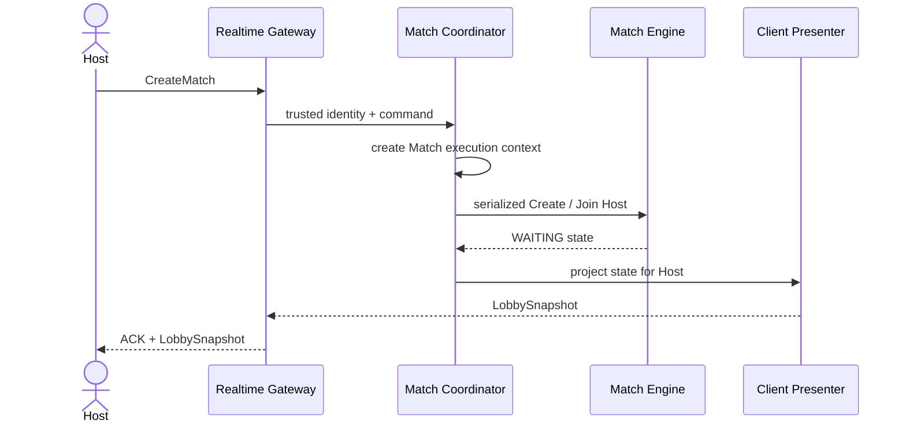

The server generates the Match identity.

The requesting participant becomes the Host and first participant.

The Match begins in `WAITING`.

#### Join Match

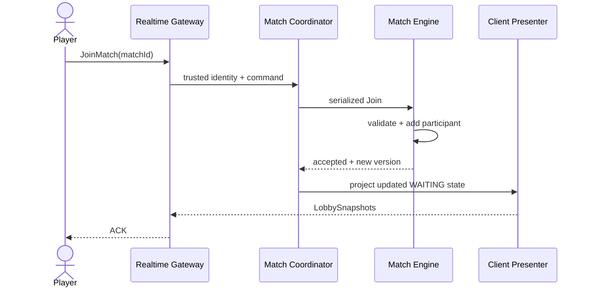

A successful Join mutates participant membership only through the Match Engine.

The updated `WAITING` snapshot is published to relevant Match clients.

A non-Host participant leaving during `WAITING` follows the same serialized
command path.

A non-Host disconnect during `WAITING` follows the same serialized Leave path and
notifies remaining lobby clients. Host departure remains open.

---

### 6.2 Start Match

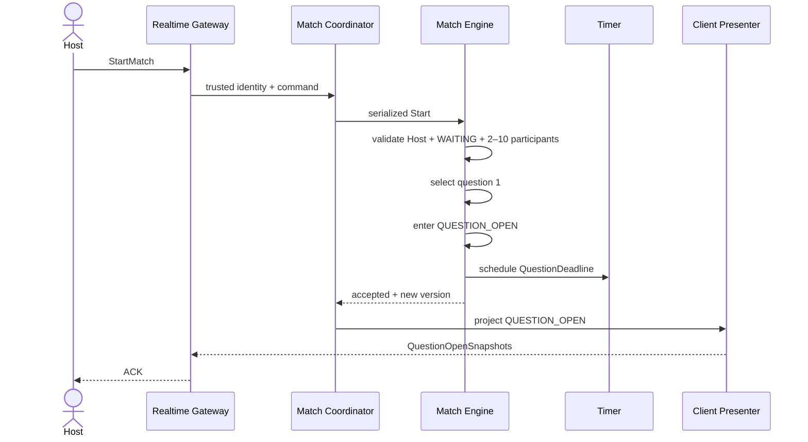

The Engine accepts `Start` only when:

- the requester is the Host;
- the Match is in `WAITING`; and
- the current participant count is 2–10.

The Engine establishes the authoritative question deadline.

The client does not determine the question, start time, or deadline.

Rejected Start commands do not mutate Match state or advance the Match
version.

---

### 6.3 Submit First Answer

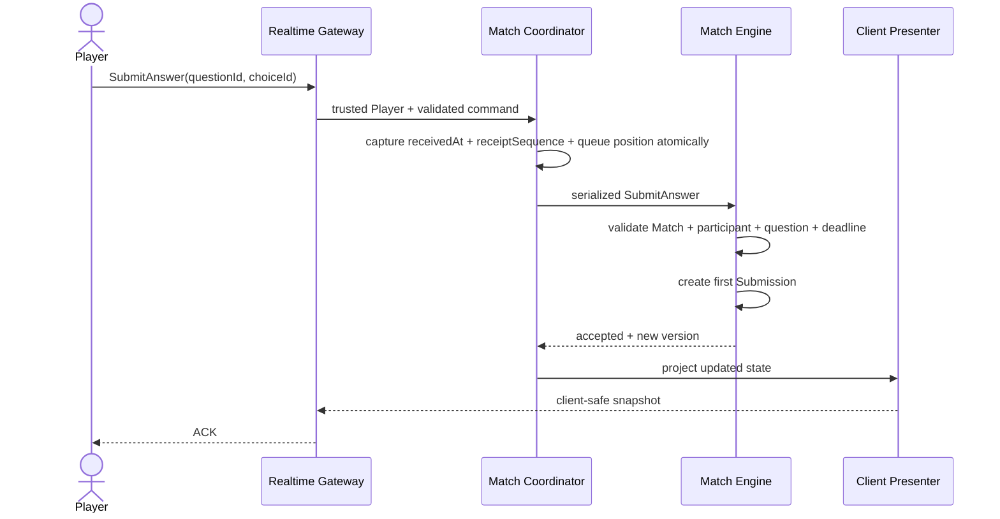

The first accepted answer creates the participant's Submission for the current
question.

```text
selectedChoice  = requested Choice
attemptCount    = 1
finalAnsweredMs = elapsed authoritative server ingress milliseconds
```

The client does not provide response time, correctness, score, or
`attemptCount`.

A duplicate command with the same `commandId` must not create or apply the
Submission twice.

---

### 6.4 Change Answer

Answer changes use the same `SubmitAnswer` command as the first submission.

```mermaid
sequenceDiagram
    actor P1 as Player
    participant G as Realtime Gateway
    participant C as Match Coordinator
    participant E as Match Engine
    participant P as Client Presenter

    P1->>G: SubmitAnswer(newChoice)
    G->>C: trusted Player + validated command
    C->>C: capture receivedAt + receiptSequence + queue position atomically
    C->>E: serialized SubmitAnswer
    E->>E: validate current Submission
    E->>E: validate attempts < 3; replace Choice + increment attemptCount
    E-->>C: accepted + new version
    C->>P: project updated state
    P-->>G: client-safe snapshot
    G-->>P1: ACK
```

An accepted change:

```text
latest accepted Choice replaces previous Choice
attemptCount += 1
```

Only the latest accepted Choice is used when the question is evaluated.

Accept at most 3 attempts. A fourth different Choice returns
`MAX_ATTEMPTS_EXCEEDED` without changing Submission, timing, score, or version.

Submitting the already-selected Choice with a new `commandId` is a no-op:

```text
selected Choice unchanged
attemptCount unchanged
response timing unchanged
```

A duplicate `commandId` is handled by command idempotency and must not apply a
change twice.

---

### 6.5 Answer vs Deadline

Answer eligibility is determined by authoritative server ingress time:

    receivedAt < deadline  → eligible
    receivedAt >= deadline → late

Player commands and `QuestionDeadline` enter the same per-Match ordered ingress
and serialized command stream.

For each admitted command, reading the authoritative clock, assigning its
receipt order, and establishing its queue position form one synchronous,
non-yielding admission operation. No asynchronous work may occur between these
steps.

Engine processing time does not affect answer eligibility. A pre-deadline answer
remains eligible if Engine processing is delayed; an answer received at or after
the deadline remains late even if `QuestionDeadline` has not yet been processed.

`QuestionDeadline` therefore acts as the close barrier in the ordered command
stream. M1 does not require a `CLOSING` state, input-drained watermark, or command
replay.

Client timestamps never determine eligibility.

---

### 6.6 Close Question & Reveal

A valid `QuestionDeadline` closes the current question after all commands admitted
before it through the ordered per-Match ingress have been processed.

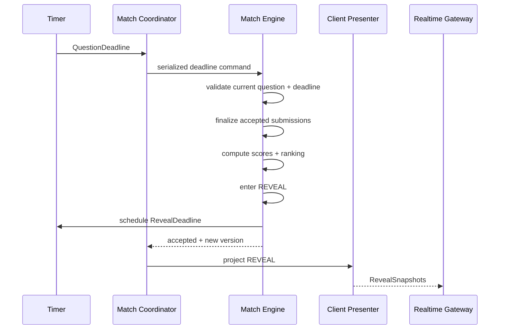

Scoring uses each participant's final accepted Submission.

```text
wrong answer   → 0
no answer      → 0

correct answer:
    correctnessScore = 10 / attemptCount
    speedBonus       = max(0, 10 - finalAnsweredAt)
    questionScore    = correctnessScore + speedBonus
```

`attemptCount` starts at `1` for the first accepted answer and increments only
when a different Choice is accepted. Re-submitting the currently selected Choice
is a no-op.

`finalAnsweredAt` is the authoritative elapsed time, in seconds, from question
open until the final accepted Choice was admitted. It is derived from server
ingress time, never from a client timestamp.

Use integer elapsed milliseconds and exact score units from Section 2.6;
no authoritative per-question or final rounding occurs.

After evaluation, the Match enters `REVEAL` for 5 seconds.

The Reveal projection may expose the correct Choice and the receiving
participant's result according to Section 5.

A stale or duplicate deadline command must not close a newer question.

---

### 6.7 Advance to Next Question

When the reveal deadline is reached and questions remain:

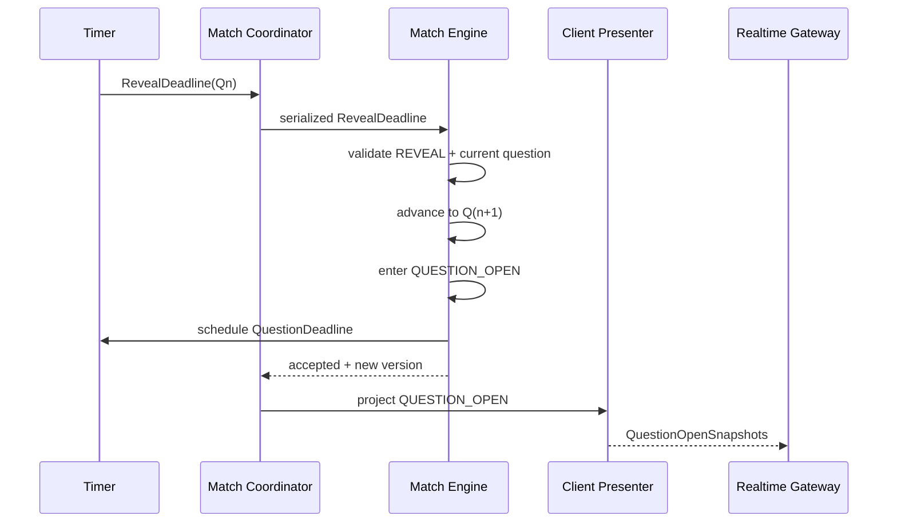

Each question receives a new authoritative answer deadline.

The transition is:

```text
REVEAL Qn
    ↓
RevealDeadline
    ↓
QUESTION_OPEN Q(n+1)
```

A stale or duplicate `RevealDeadline` from an earlier question must not advance
the current Match.

---

### 6.8 Finish Match

After the reveal period for question 10, the Match becomes terminal.

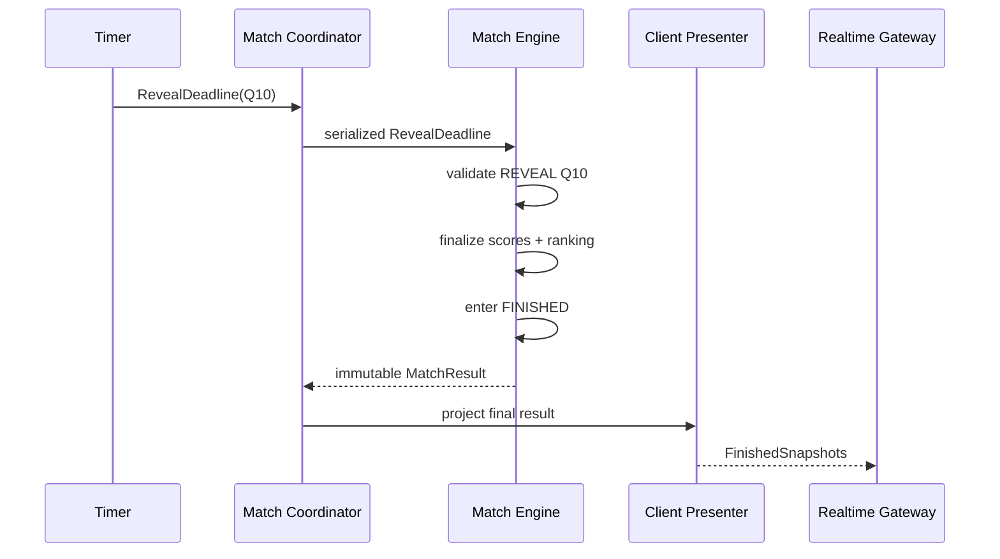

Final scores are the accumulated authoritative question scores produced by the
Match Engine. Ranking uses the full accumulated score without per-question
rounding.

Exact full-score equality produces a shared rank.

```text
REVEAL Q10
     ↓
RevealDeadline
     ↓
FINISHED
     ↓
MatchResult
```

After `FINISHED`:

- gameplay state is immutable;
- gameplay commands are rejected;
- scores and ranks cannot change; and
- stale or duplicate timer commands cannot cause further transitions.

The Match Engine produces an immutable `MatchResult`; it does not directly
persist the result.

---

### 6.9 Persist Completed Match

Required M1 flow:

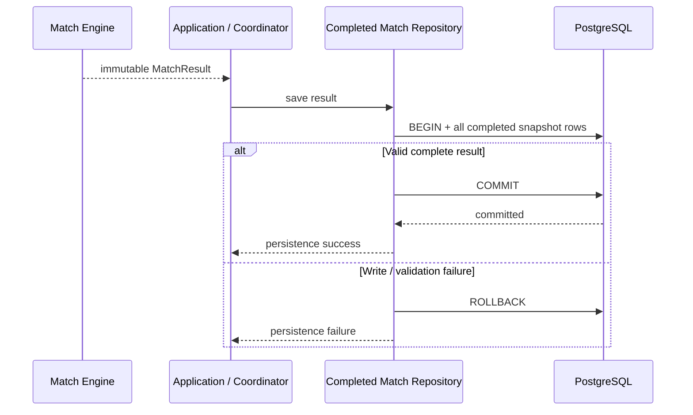

History visibility requires commit. `FINISHED` gameplay state remains immutable even
if persistence fails. Retain the result for approved application-level retries;
crash recovery before commit is not an M1 guarantee. Identical retries are
idempotent; conflicting completed results fail. See database design §§9–10.

## 7. Data & Database Design

Active Match state is authoritative in memory. PostgreSQL stores durable Player identity and immutable completed-Match history; it does not participate in active gameplay coordination.

Database shape, runtime domain shape, and client DTOs are separate concerns.

### 7.1 Runtime Data Model

An active Match is owned by one in-process Match Engine instance. Runtime structures optimize authoritative command processing and are not persistence models.

#### Match State

```ts
interface MatchState {
  id: MatchId;
  hostPlayerId: PlayerId;
  phase: MatchPhase;
  rules: MatchRules;

  participants: Map<PlayerId, ParticipantState>;

  currentQuestionIndex: number | null;
  currentQuestion: QuestionState | null;
  resolvedQuestions: ResolvedQuestionResult[];

  version: number;
}
```

The Match Engine is the only component that mutates this state.

Retain authoritative Match start/finish timestamps and resolved question results
for the immutable completion result. Persistence must not substitute its own
write time for those gameplay facts. The interfaces here are runtime sketches,
not a second persistent schema.

Operational state such as the current phase, active deadline, timer handles, command queue, socket connections, and command-idempotency cache is not written to PostgreSQL. Active-Match restart recovery is not an approved requirement.

#### Participant State

```ts
interface ParticipantState {
  playerId: PlayerId;
  submissions: Map<QuestionId, SubmissionState>;
  scoreUnits: bigint;
}
```

`playerId` is the durable Player identity resolved before gameplay commands reach the Match Engine.

Connection identity is not Player identity and is not stored in Match state as the durable participant key.

#### Question State

```ts
interface QuestionState {
  id: QuestionId;
  text: string;
  choices: Choice[];
  correctChoiceId: ChoiceId;

  openedAt: ServerTime;
  deadlineAt: ServerTime;
}
```

The initial/default hard answer window is ten seconds; approved early-close
configuration may eventually close sooner, never extend it.

Retain ordered played question/Choice content and per-participant evaluated results
in `resolvedQuestions` as rounds resolve. Their exact units, attempts, and timing
feed `MatchResult`; keeping only the current question or final totals is insufficient
for self-contained History.

Question content required to reconstruct completed history is copied into the completed result rather than later read from mutable source content.

#### Submission State

```ts
interface SubmissionState {
  choiceId: ChoiceId;
  attemptCount: 1 | 2 | 3;
  finalAnsweredMs: number;
}
```

The first accepted answer creates the submission with `attemptCount = 1`.

Changing to a different choice increments `attemptCount`. Re-submitting the currently selected choice is a no-op.

After three accepted attempts, a different-choice submission is rejected with `MAX_ATTEMPTS_EXCEEDED`. The rejection does not mutate the submission, score, Match state, or Match version.

`finalAnsweredMs` is derived from authoritative server ingress time and is valid only in:

```text
0 <= finalAnsweredMs < 10_000
```

A participant with no accepted answer has no `SubmissionState` for that question.

#### Score State

Runtime scoring uses integer score units only.

```ts
type ScoreUnits = bigint;
```

Question scores are accumulated directly into the participant's `scoreUnits`. Floating-point or presentation-decimal values are never authoritative for scoring, equality, or ranking.

#### Runtime Lookups

The implementation may use maps or sets required by the approved runtime semantics, including:

```text
playerId   → ParticipantState
questionId → SubmissionState
commandId  → processed command result
```

Same-Match command serialization and command idempotency remain runtime concerns. These lookup structures are not durable database tables.

### 7.2 Persistent Data Model

The [database design](database-design.md) owns persistent field definitions,
the ER diagram, keys, checks, composite Choice relationships, and query indexes.
Do not duplicate a second schema in runtime models.

`MatchResult` supplies the entire immutable historical graph:
`GAME_MATCH`, `MATCH_PARTICIPANT`, `MATCH_QUESTION_SNAPSHOT`,
`MATCH_QUESTION_CHOICE_SNAPSHOT`, `MATCH_ANSWER_SNAPSHOT`.

### 7.3 Entity Relationship Diagram

See [database design §3](database-design.md#3-entity-relationship-diagram).

### 7.4 Tables

See [database design §4](database-design.md#4-tables). Runtime identity is durable
`PlayerId`, distinct from credential, socket, and Match-local choice keys.

### 7.5 Keys & Constraints

See [database design §§4–6](database-design.md#4-tables). Before commit validate
participant cardinality, Host membership, complete question/result coverage,
correct/selected Choice membership, scores, ranks, and shared completion timestamp.

### 7.6 Access Patterns & Indexes

See [database design §8](database-design.md#8-access-patterns-and-indexes).
History List uses `(player_id, finished_at DESC, match_id DESC)`.
Detail requires participation authorization and reconstructs bounded Match snapshots.
Cursor format, stored participant count, and permanent source lineage remain open.

### 7.7 Score Representation

Runtime `ScoreUnits = bigint`; PostgreSQL question/final score fields use `BIGINT`.
Elapsed answer time uses integer milliseconds (`INTEGER` in PostgreSQL).
Scoring is defined once in Section 2.6; JSON carries exact units as decimal strings.
Any scoring denominator, attempt limit, timing resolution, or score-bound change
requires revalidating the scale and integer bounds.

### 7.8 Persistence Lifecycle

See Section 6.9 and [database design §§9–10](database-design.md#9-completed-match-persistence).
One immutable result → validated atomic transaction → History-visible commit.
All Match/participant `finished_at` values come from the same `MatchResult.finishedAt`.
No active state, queues, timers, or command-idempotency cache is persisted for recovery.

## 8. Error & Validation Model

### 8.1 Validation Layers

| Layer | Authority |
|---|---|
| Transport | Envelope, recognized type, required fields, primitive/enum formats, payload bounds |
| Application | Authenticated Player, Match lookup, routing, atomic admission, serialization, idempotency |
| Domain | Phase, membership, Host, question/Choice, deadline, attempts, transitions |

Validate before mutation. Client-side checks are UX only.

### 8.2 Transport Validation

Gateway rejects malformed messages before admission. Do not decide gameplay rules
or accept client-owned identity, timing, correctness, or score.

### 8.3 Application Validation

Resolve trusted `PlayerId` and Match execution context. Capture ingress metadata and
queue position without yielding. Return processed duplicate command outcomes.
Unauthenticated access and unknown Match are application failures, not domain errors.

### 8.4 Domain Validation

- Start: current `WAITING`, requester Host, current count 2–10.
- Submit: `QUESTION_OPEN`, participant, current played question, valid Choice,
  authoritative `receivedAt < deadline` and valid elapsed milliseconds.
- Then apply Section 2.5 attempt/no-op rules. A fourth different Choice is rejected;
  same Choice does not consume an attempt or replace timing.
- Timers: current phase, played question, scheduled deadline, and time reached.
- `FINISHED`: no gameplay mutations, including after persistence failure.

Internal processing delay and client timestamps cannot affect eligibility.

### 8.5 Domain Error Model

Stable machine-readable outcomes; client logic uses codes, not messages.
Rejection and successful no-op are distinct, but neither mutates state or version.

| Code | Applies To | Meaning | State Mutated? |
|---|---|---|---:|
| `NOT_MATCH_PARTICIPANT` | Match command | Player is not a current participant. | No |
| `NOT_HOST` | Start | Player is not the Match Host. | No |
| `INVALID_MATCH_PHASE` | Match command | Command is not valid in the current phase. | No |
| `INSUFFICIENT_PARTICIPANTS` | Start | Fewer than two participants are present. | No |
| `QUESTION_NOT_CURRENT` | Submit | Command targets a non-current question. | No |
| `INVALID_CHOICE` | Submit | Choice does not belong to the current question. | No |
| `ANSWER_WINDOW_CLOSED` | Submit | Authoritative `receivedAt >= deadline`. | No |
| `MAX_ATTEMPTS_EXCEEDED` | Submit | Three attempts have already been accepted; another different Choice is requested. | No |
| `MATCH_FINISHED` | Mutating Match command | Completed Match state is immutable. | No |

Malformed transport errors and application failures such as `MATCH_NOT_FOUND`
remain separate. Messages must not leak sensitive/internal details.

### 8.6 Expected vs Unexpected Failures

Expected rejection returns the structured outcome without mutation.
Programming errors, invariant violations, infrastructure/persistence failures are
server failures—not invented gameplay rejections.
Completion failure rolls back; do not claim durable success until commit.
Gameplay stays `FINISHED`; see Section 6.9.

### 8.7 Logging Rules

- Commands: `commandId`, type, `matchId`, `playerId`, phase/version, outcome/error code.
- Timing diagnostics: `receivedAt`, `receiptSequence`, deadline, `finalAnsweredMs`.
- Transitions: Match identity, previous/next phase, resulting version.
- Timer/clock infrastructure failures: Match identity and safe failure context;
  Slice 4 runtime composition reports these at error level without recovery.
- Persistence failures: Match identity and failure context.
- No passwords, hashes, secrets, credential payloads, unnecessary private data, or
  pre-reveal answer keys in ordinary logs/client errors.
- Distinguish expected rejection from error-level unexpected failures; telemetry
  must not block gameplay or determine correctness.

## 9. Test Design

### 9.1 Test Boundaries

Engine tests need neither NestJS, Socket.IO, nor PostgreSQL. Use controlled time
without real sleeps. Test Coordinator ordering, realtime projection contracts,
PostgreSQL integrity, and narrow integrated flows at their respective boundaries.

### 9.2 Match Engine Unit Tests

- Lobby: creator Host/first participant; WAITING joins; duplicate/over-capacity rejection;
  non-Host leave/disconnect removal; Host Start only with current 2–10 participants.
- Submissions: first attempt 1; latest different Choice; wrong→correct/correct→wrong;
  same-Choice no-op; invalid Choice/question/nonparticipant rejection; fourth
  different-choice rejection, including unchanged Submission/time/score/version.
- Assert both command outcome and unchanged state for every rejection/no-op.

### 9.3 State Machine Tests

Exercise each Section 3 transition and incompatible command/phase.
Exactly ten questions, each with 5-second reveal; finish only after reveal 10.
Stale/duplicate timers cannot transition another question or a terminal Match.
Default `earlyClose=false`; no `CLOSING` state or unapproved early-close behavior.

### 9.4 Scoring & Ranking Tests

Verify attempt correctness units 30,000,000 / 15,000,000 / 10,000,000; speed units
`(10_000 - finalAnsweredMs) * 3_000`; wrong/no-answer zero.
Cover attempts 1–3, milliseconds 0 and 9999, changes/no-ops/rejections, total sums,
descending ranking, exact ties/co-winners, and formatting independence.

Exact-equality regression (remaining questions unanswered):

```text
3 × attempt-3 correct at 9999ms
= 1 × attempt-1 correct at 9997ms
= 30_009_000 score units (10.003 points)
```

No floating-point comparisons or authoritative rounding.

### 9.5 Deadline Boundary Tests

For `deadline = openedAt + 10_000ms`:
`deadline - 1ms` eligible; exact deadline and `deadline + 1ms` late.
Verify accepted elapsed range 0..9999ms and client timestamps cannot change outcomes.

### 9.6 Concurrency / Ordering Tests

- Same-Match receipt-order execution, including rapid changes; independent Match paths.
- Clock capture, receipt sequence, queue placement are non-yielding.
- Accepted/rejected processed command retries return their original outcomes once.
- Pre-deadline admitted answer delayed past wall-clock deadline remains eligible;
  at/after-deadline answer remains late even if timer processing is delayed.
- Timer admission at/after deadline preserves the earlier-answer close barrier.

### 9.7 Realtime Contract Tests

Malformed input never enters domain execution; trusted connection resolves Player;
ACK/error codes survive transport unchanged; duplicates return established outcomes.
Actual mutation publishes safe viewer-specific snapshots; no-op/rejection adds no version.
Older/duplicate snapshots are ignored. QUESTION_OPEN excludes answer keys, correctness,
other selections, and private evaluation fields.

### 9.8 Persistence Tests

- Identity independent of sessions; unique username; credentials resolve correct Player;
  gameplay/History reference Player, not credential.
- Full atomic graph: Match, participants, ten questions, presented Choices, every
  participant/question result, final totals/ranks, shared completion timestamp.
- Force partial-write failure: rollback leaves no visible completed Match.
- Constraint rejection: bad question position, negative score, invalid attempt,
  answered row missing timing, 10,000ms answer, cross-question selected/correct
  Choice, missing participant, duplicate participant/question result.
- Identical full-result retry succeeds; conflicting retry fails.
- Mutate/delete source question fixture after persistence; original snapshot content,
  order, correct Choice, answers, attempts/timing, awarded scores/ranks remain identical.
- List uses completion time + Match ID ordering; equal timestamps deterministic.
  Detail authorization rejects nonparticipants; bounded reads use existing indexes.
- Integer time/score fields round-trip, sum, compare, order, and share ranks exactly.

### 9.9 End-to-End Critical Path

Authenticate Host → Create → authenticate/join second Player → Host Start
→ ten question/reveal cycles → FINISHED/immutable result → commit
→ participant History List/Detail.

Verify identities, authority, exact score/rank, atomic visibility, historical
reconstruction, and all phase transitions using controlled time.

## 10. Open & Deferred Decisions

### 10.1 Open Questions

- History cursor representation, page-size limits, response metadata, malformed/stale
  cursor behavior; retain the approved chronological physical access path.
- Stored versus derived completed participant count.
- Permanent source Question/Choice lineage; snapshots remain independently reconstructable.
- Authentication/session decisions are settled in §5.7; password-creation policy remains open.
- Source-lineage identifier representations and deletion/retention policy remain
  unfrozen; Slice 5 approves Player/Match UUIDs and the documented composite keys.

### 10.2 Explicitly Deferred

- Host leave in WAITING; no host migration/cancellation default is approved.
- Active Match disconnect/reconnect/leave: no grace period, replacement bot, or recovery policy.
- `earlyClose=true` policy; no all-answered shortcut/settle/reset timer.
- Bots and tournament orchestration; extensions stay outside Match gameplay branches.
- Active-Match restart recovery, durable gameplay queues, distributed ownership/coordination.
- Persistent Question Bank authoring/versioning/deletion/audit workflow and source FK policy.
- Human-facing decimal score formatting; it cannot change integer equality/ranking.

Capacity, latency, availability, RTO/RPO, spectators, localization/accessibility,
and deeper anti-cheat/dispute requirements remain open in system design §5.

### 10.3 Decisions Requiring HLD Update

See [system design §22](system-design.md#22-architectural-guardrails).
Update architecture before introducing services/Redis/brokers/distributed ownership,
active-state recovery or command logs, changing authoritative timing/admission,
making PostgreSQL active-game authority, weakening atomic completion, or introducing
outbox/durable completion workers as required infrastructure.

Local types/structure may be refined, not authority, lifecycle, or durability guarantees.
